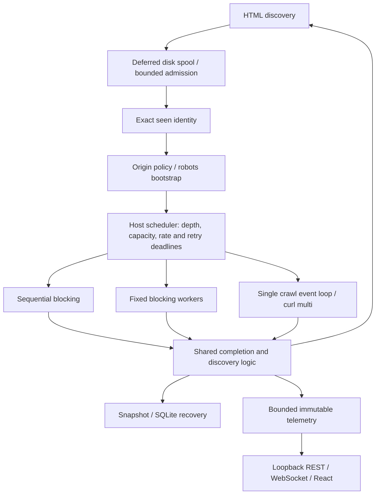

# FluxCrawl

FluxCrawl is a C++20 crawler and concurrency laboratory. It runs the same high-I/O
workload with sequential blocking I/O, a fixed blocking thread pool, and a
single-threaded libcurl multi event loop, then measures their behavior against
deterministic local workloads.

**0.1.0 release candidate.** See the actual [certification results](docs/certification.md)
and remaining gates before tagging. FluxCrawl is a systems experimentation
project, not an internet-facing multi-tenant service or a general scraper UI.

The shared core provides host-aware scheduling, rate limits, retries, robots
policy, bounded admission, durable recovery, and exact deduplication. Benchmarking,
profiling and a local observability dashboard expose the tradeoffs rather than
claiming that one execution model always wins.

## Build and quick start

Requires CMake 3.20+, a C++20 compiler, libcurl 7.85+, libxml2, SQLite 3.24+, and
Threads. The optional dashboard server additionally requires Boost 1.81+ with
Beast/Asio and Boost.JSON. Python 3 is needed for tests. Node 22.16+ is needed
only to develop/build/test the optional React dashboard.

On Ubuntu 24.04:

```sh
sudo apt-get update
sudo apt-get install -y cmake g++ libcurl4-openssl-dev libxml2-dev libsqlite3-dev libboost-json-dev python3
cmake -S . -B build
cmake --build build -j 4
ctest --test-dir build --output-on-failure
./build/fluxcrawl --version
```

On macOS, install Command Line Tools and `brew install cmake boost`; the SDK can
provide curl/libxml2/SQLite, or install their development packages with Homebrew.
GCC and Clang are covered by the configured CI matrix. Windows is not certified.

For a C++ core/CLI build without Boost or Node:

```sh
cmake -S . -B build-core -DFLUXCRAWL_OBSERVABILITY=OFF
cmake --build build-core -j 4
```

For the local dashboard, build its static assets separately:

```sh
cd dashboard
npm ci
npm run test
npm run typecheck
npm run build
cd ..
cmake -S . -B build-release -DCMAKE_BUILD_TYPE=Release
cmake --build build-release -j 4
python3 tools/dashboard_demo.py
```

Open the printed loopback URL. The deterministic demo uses only local servers and
temporary state; it shows multiple origins, varied delays, retries, robots blocks,
queue pressure, Bloom dedup and SQLite commits. It lasts roughly 30–90 seconds and
is excluded from normal CI. Node is not required to run the built dashboard.

For a conservative public crawl, explicitly enable politeness policies:

```sh
./build/fluxcrawl --engine async --concurrency 2 --max-per-host 1 \
  --rate-per-host 1 --burst-per-host 1 --respect-robots \
  --max-retries 1 --depth 1 --max-pages 25 https://example.com/
```

Use `--help` for grouped crawl, engine, scheduling, retry, policy, persistence,
dedup and observability options. `benchmark --help` and `resume FILE` are separate
commands. No public sites are used for certification or benchmarks.

## Architecture and correctness



Sequential fetches one request at a time. Threaded execution uses fixed workers
and synchronized shared state. Async execution multiplexes transfers on one crawl
event-loop thread; it does not create request-worker threads. Transport setup,
URL identity, discovery, retry/robots policy, scheduling, dedup and persistence
semantics are shared. Observability has its own I/O thread; optional samplers for
the blocking engines do not change their request execution model.

A canonical URL is accepted once at discovery. Fragments are removed, default
ports normalized, and queries preserved. A retry is another attempt on the same
logical resource, not a new URL. Depth barriers preserve shortest discovered depth
under concurrency. `max_pages` caps resource **attempts**, including retries;
robots bootstrap attempts are accounted separately. Robots blocks never consume
resource fetch attempts. Per-origin caps apply to scheduler claims, including
robots and retries. Redirect hops are followed by curl inside the original claim.

Backpressure bounds admitted unfinished resources with high/low hysteresis.
Unadmitted extracted links are retained in a disk spool, not silently dropped.
Bloom is only a prefilter: maybe hits always receive an exact SQLite/cache check.
Snapshots preserve unfinished logical work; SQLite restores only its committed
prefix. Active or uncommitted attempts may run again after a crash: recovery is
**at least once**, not exactly-once network delivery. See the [invariant/test map](docs/certification.md).

## Design tradeoffs

| Choice | What it buys / what it costs |
| --- | --- |
| Blocking workers vs async | Straightforward blocking control flow and parallel parsing vs fewer request threads and serialized completion processing |
| Memory exact vs SQLite exact | Fast in-memory membership vs disk-backed seen identity, SQL/transaction overhead and a bounded uncommitted cache |
| Bloom prefilter | Avoids some negative DB lookups; costs fixed bitmap memory and rebuild time, and loses effectiveness when saturated |
| Snapshot vs incremental persistence | Simple portable whole-state recovery vs incremental durable mutations and single-process DB ownership |
| Backpressure | Bounds admitted work; moves discovery pressure to temporary/durable disk I/O rather than promising constant total memory |
| Batch size | Fewer commits and higher throughput vs a larger uncommitted suffix that may be replayed after a crash |
| Observability detail | Bounded sampled state is cheap enough to inspect; full URL histories and exact global host rankings are deliberately omitted |

The [design notes](docs/design-notes.md) explain the ownership and failure model.
The [benchmark report](docs/benchmark-report.md) records actual machine-scoped
measurements and variance; there is no universal async-vs-threaded ranking.

## Live Observability

Use `--dashboard`, optionally `--dashboard-port 8080`,
`--metrics-interval-ms 500`, and `--dashboard-topology`. Binding is **127.0.0.1**,
with a printed actual port (`0` selects a free port). The API is read-only, with
schema version 1 and `/api/status`, `/api/metrics`, `/api/hosts`, `/api/topology`,
and `/ws`. The React UI shows progress, rolling throughput, recent latency,
workers/transfers, hosts, retries, robots, pressure, dedup/Bloom, storage and a
sampled origin graph.

Engines publish immutable snapshots; the server never walks live crawler
containers. Telemetry is sampled, bounded and best-effort. Limits include 4096
recent latency samples, 32 host rows from 256 candidates, 64 graph nodes/128
edges, 16 connections and one in-flight message per client. Slow clients skip
stale data and disconnect on a bounded write deadline. The browser retains five
minutes of history and reconnects with backoff. Final state remains available for
`--dashboard-linger-ms 2000` before automatic CLI exit. See [observability](docs/observability.md).

## Defaults and failures

| Default | Value |
| --- | --- |
| Engine / workers / async concurrency | sequential / 4 / 8 |
| Depth / resource attempt budget | 2 / 100 |
| Per-origin cap / rate limit | unlimited / disabled |
| Retry count / initial delay / cap / jitter | 0 / 250 ms / 5000 ms / enabled |
| Robots | ignored unless explicitly enabled |
| Pending high / low | 10000 / 7500 |
| Dedup / Bloom design capacity / FP target | memory / 1,000,000 / 0.01 |
| Persistence | disabled; SQLite batch defaults to 100 mutations |
| Dashboard / interval / topology | off / 500 ms / off |

Defaults preserve reproducible historical CLI semantics, not a claim of ideal
public-site politeness. Use the explicit conservative recipe above. Benchmark
mode intentionally disables politeness/persistence/dashboard for architecture
comparisons; advanced features are measured separately.

Exit codes: **0** success or a clean budget stop; **1** runtime/terminal fetch
failure; **2** CLI/configuration error; **3** persistence/resume failure. HTTP
errors are recorded, with terminal retry exhaustion reflected when retries are
enabled. Snapshot write failures retain the last good primary and surface an
error; SQLite failure stops durable progress and retains a committed prefix.
Corrupt or inconsistent state is rejected before restoration. Details:
[retries](docs/retries.md), [robots](docs/robots.md),
[checkpointing](docs/checkpointing.md), [SQLite](docs/persistence.md).

## Certification and reproducibility

```sh
cmake -S . -B build-asan -DFLUXCRAWL_SANITIZER=address-undefined -DCMAKE_BUILD_TYPE=Debug
cmake --build build-asan -j 4
ctest --test-dir build-asan --output-on-failure

cmake -S . -B build-fuzz -DCMAKE_CXX_COMPILER=clang++ -DFLUXCRAWL_ENABLE_FUZZING=ON \
  -DFLUXCRAWL_OBSERVABILITY=OFF -DBUILD_TESTING=OFF -DCMAKE_BUILD_TYPE=RelWithDebInfo
cmake --build build-fuzz -j 4
python3 tools/fuzz_smoke.py
```

Use a separate `FLUXCRAWL_SANITIZER=thread` build for TSan. Tests have unit,
integration, concurrency, recovery, persistence, stress, fuzz and benchmark labels.
Heavy 10k/100k tests require `-DFLUXCRAWL_SLOW_TESTS=ON`; the ten-minute lifecycle
soak is manual: `python3 tools/certification_soak.py`. Serialize heavy network
suites; simultaneous connection churn can exhaust loopback resources independently
of crawler memory. Normal correctness assertions are not relaxed for benchmarks.

Official Release profiles, warmups, repetitions, graphs and commands are in
[benchmark certification](docs/benchmark-report.md). Run
`python3 tools/certification_benchmarks.py` and
`python3 tools/certification_advanced.py` separately on an otherwise idle machine.
Plotting needs Python matplotlib and is independent of the C++ build.

## Scope and limitations

* Single process, no distributed/multi-machine control or JavaScript/browser rendering.
* Robots is a documented literal-prefix subset, without wildcard, `$`, Sitemap
  or Crawl-delay semantics. Policy bootstrap failures deny that origin.
* Politeness is keyed by scheme/host/port, not DNS/IP identity. Redirect destinations
  do not acquire separate scheduler leases, and robots is not reevaluated per hop.
* No HTTP response cache. Blocking requests create fresh easy handles; repeated
  short-lived sessions can incur connection churn. Async completion/HTML work is
  serialized on the crawl loop.
* Pending work, active slots and telemetry are bounded. Retained attempt records,
  host state, exact memory seen sets and disk spool/database size can still grow.
* SQLite has one logical owner. Snapshot files have a 64 MiB limit and need their
  discovery companions. Atomic replacement does not claim full directory-fsync
  power-loss durability on every filesystem.
* Host telemetry is a capped candidate sample; topology is sampled discovery offers,
  not a complete graph. Dashboard assets are built separately and served from the
  source checkout (or a directory supplied by a library embedder).
* The dashboard has no authentication/control plane and is local-only. JavaScript
  numbers cannot represent arbitrary 64-bit counts exactly. Windows and browser
  visual QA require separate certification; see the actual results table.

## Repository and license

`include/fluxcrawl/` and `src/` contain the shared core and engines; `tests/` and
`fuzz/` contain deterministic certification; `tools/` contains fixtures,
benchmarks, soak and source-release utilities; `dashboard/` contains the optional
React console; `docs/` contains design, measurements and policy details.

[MIT license](LICENSE). See [third-party notices](THIRD_PARTY_NOTICES.md) and
[CHANGELOG](CHANGELOG.md). Unbuilt instructional examples were removed from the
release tree; their original attribution remains in Git history. Source releases
contain committed files only and do not bundle system or npm dependencies.
