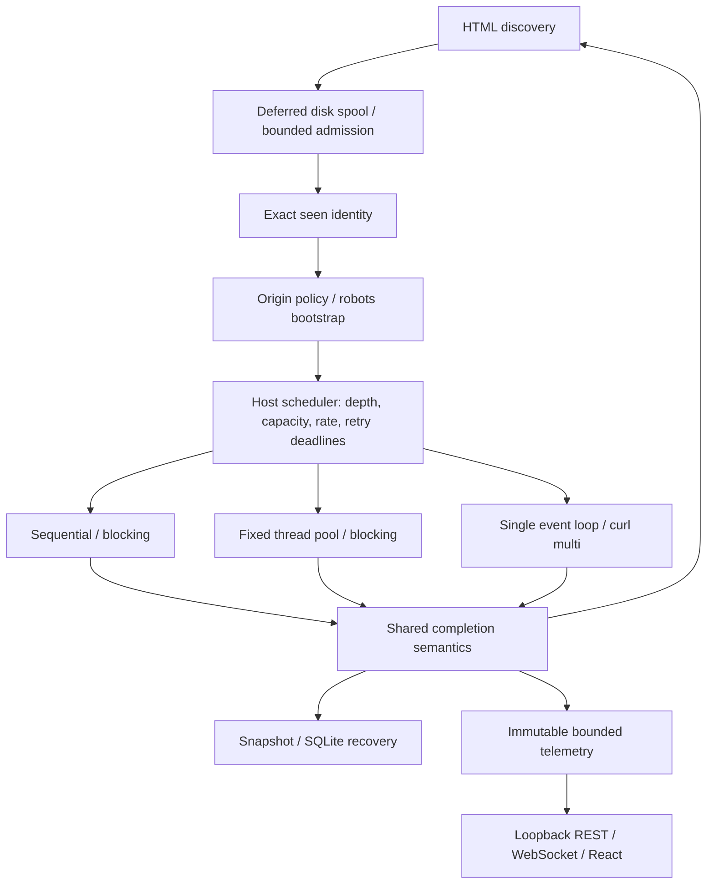
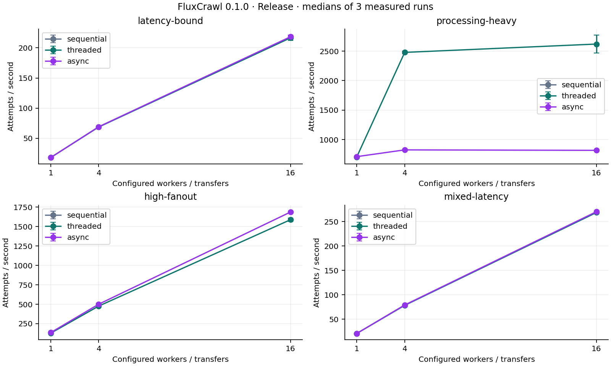

# FluxCrawl

**A C++20 network-concurrency and performance-engineering platform.** FluxCrawl
runs the same crawling workload using sequential blocking I/O, a fixed blocking
thread pool, and a single-threaded event-driven libcurl multi loop. Controlled
local workloads expose how each architecture handles latency, processing,
scheduling, resource pressure and recovery.

Crawling supplies the workload; concurrency architecture is the experiment.
**Version 0.1.0 is a prepared release candidate:** local certification is recorded,
while remote CI, Linux leak detection and browser visual QA remain tag gates.



## Why I Built This

Implementing one networking model leaves its tradeoffs hard to separate from the
workload. FluxCrawl keeps logical crawl semantics consistent across three models
so those tradeoffs can be measured: when do threads help, when does processing
limit an event loop, what happens when discovery outruns consumption, and what do
exact deduplication and durability cost?

## Execution Engines

| Engine | Request execution | Coordination | Strength / cost |
| --- | --- | --- | --- |
| Sequential | One blocking request at a time | One crawl thread | Reference baseline; cannot overlap request latency |
| Threaded | Fixed workers, blocking libcurl per worker | Shared coordinator mutex and condition variable | Overlaps I/O and parsing; worker and synchronization costs |
| Async (`AsyncCrawler`) | Multiple transfers on one libcurl multi loop | Crawl state owned by event loop | No request-worker threads; HTML/completion processing is serialized |

Async uses `curl_multi_perform`, completion messages and `curl_multi_poll`, with
slot refill after completions. It uses neither C++ coroutines nor async/await.
The optional observability server has its own I/O thread; blocking-engine samplers
also run separately. “Single-threaded async” describes crawl execution.

## Architecture

All engines use the same canonical URL model, libxml2 parser, depth semantics,
exact deduplication, policy rules, host scheduler and result model. Engines own
different execution loops rather than independent crawl policies. This controls
logical workload differences when comparing architectures.

Canonical identities are accepted at admission, before fetching; deferred
candidates remain unseen until admitted. Retries retain identity and depth.
`max_pages` limits resource **attempts**, including retries; robots bootstraps are
separate. Depth barriers prevent a deeper discovery from winning while shallower
requests remain active. See the [URL lifecycle walkthrough](docs/design-walkthrough.md).

## Core Systems Features

* **Scheduling and policy:** origin queues, round-robin fairness, per-origin active
  caps, token buckets and an opt-in literal-prefix robots policy.
* **Failure handling:** shared retry classification, exponential backoff, full
  jitter, Retry-After and delayed scheduling without retry worker threads.
* **Admission and exactness:** high/low watermarks bound admitted unfinished work;
  deferred discoveries go to disk. Threaded producers finish publication and
  become consumers again, avoiding an all-producers-wait deadlock.
* **Storage:** MemoryExact holds identities in RAM; SQLiteExact uses disk-backed
  exact membership. Bloom+SQLite uses Bloom as a negative prefilter: **false
  positives cause extra exact checks, never skipped URLs**.
* **Measurement:** deterministic fixtures, throughput/latency percentiles,
  optional operation profiling and bounded live telemetry.

## Performance Experiments

Measured on Apple M3, macOS 15.0.1, Apple Clang 16, C++20 Release; medians of three
runs with one excluded warmup per configuration. These are local fixture results,
not public-internet capacity claims.

| Attempts/s | Sequential | Threaded / 16 workers | Async / 16 slots |
| --- | ---: | ---: | ---: |
| 50 ms latency-bound | 18.1 | 216.5 | 218.3 |
| Processing-heavy / repeated links | 704.9 | 2619.4 | 818.2 |
| High-fanout / 5 ms delay | 134.7 | 1588.4 | 1687.0 |

Concurrency overlaps latency in the first profile. In the processing-heavy
profile, async is near its plateau by four slots; parallel worker parsing wins.
At concurrency one, the engines have similar throughput. There is no universal
async advantage. On a separate 100k-identity, 95%-absent query experiment, correctly
sized Bloom reduced exact database checks from 100,000 to 5,906; saturation
removed that benefit without changing answers.



The [benchmark report](docs/benchmark-report.md) contains all 84 architecture
samples, P95 latency plots, variation, feature experiments and raw data. The
[optimization report](docs/optimization-report.md) records a matched parser
optimization and its controls; historical and current measurements are kept distinct.

## Live Observability

Use `--dashboard`, optionally `--dashboard-port 8080`,
`--metrics-interval-ms 500`, and `--dashboard-topology`. Binding is **127.0.0.1**,
with a printed actual port (`0` selects a free port). The API is read-only, with
schema version 1 and `/api/status`, `/api/metrics`, `/api/hosts`, `/api/topology`,
and `/ws`. The React UI shows progress, rolling throughput, recent latency,
workers/transfers, hosts, retries, robots, pressure, dedup/Bloom, storage and a
sampled origin graph.

Engines publish immutable snapshots; the server never walks live crawler
containers. Telemetry is sampled, bounded and best-effort. Limits include 4096
recent latency samples, 32 host rows from 256 candidates, 64 graph nodes/128
edges, 16 connections and one in-flight message per client. Slow clients skip
stale data and disconnect on a bounded write deadline. The browser retains five
minutes of history and reconnects with backoff. Final state remains available for
`--dashboard-linger-ms 2000` before automatic CLI exit. See [observability](docs/observability.md).

No verified browser screenshot is checked in. Use the deterministic demo below;
browser visual QA remains unexecuted in the certification record.

## Reliability & Recovery

Snapshots rewrite full logical state using validated temporary-file replacement;
SQLite commits incremental mutations in transactions. Seen identity and work
state must commit together. Batching reduces transaction overhead while enlarging
the suffix that can be replayed. Active sockets cannot be checkpointed: active
or uncommitted attempts may run again after a crash, so recovery is **at least
once**, not exactly-once HTTP execution. Resume can select a different engine.

Checkpoint companions are part of recovery state. Failed snapshot replacement
preserves the previous primary; failed SQLite transactions retain the committed
prefix. See [checkpointing](docs/checkpointing.md), [SQLite persistence](docs/persistence.md)
and the [reproducible resume examples](docs/demo.md#recovery-examples).

## Build

Requires CMake 3.20+, C++20, libcurl 7.85+, libxml2, SQLite 3.24+ and Threads.
The default optional telemetry server requires Boost 1.81+ (Beast/Asio/JSON).
Python 3 runs fixtures/tests. Node 22.16+ builds/tests the optional React assets.

On Ubuntu 24.04, install dependencies before the quick start:

```sh
sudo apt-get update
sudo apt-get install -y cmake g++ libcurl4-openssl-dev libxml2-dev libsqlite3-dev libboost-json-dev python3
```

On macOS, install Command Line Tools and `brew install cmake boost`; the SDK can
supply curl/libxml2/SQLite, or install development packages with Homebrew.
For a core/CLI build without Boost or Node:

```sh
cmake -S . -B build-core -DFLUXCRAWL_OBSERVABILITY=OFF
cmake --build build-core -j 4
```

## Quick Start

From the repository root:

```sh
cmake -S . -B build
cmake --build build
ctest --test-dir build --output-on-failure
./build/fluxcrawl --version
```

Start a deterministic local site in one terminal:

```sh
python3 tools/benchmark_server.py --port 8081 --scenario latency-bound
```

In another terminal:

```sh
./build/fluxcrawl --engine async --concurrency 4 --depth 20 --max-pages 100 http://127.0.0.1:8081/page/0
```

For the full systems demo, build static assets and the Release executable:

```sh
cd dashboard
npm ci
npm run test
npm run typecheck
npm run build
cd ..
cmake -S . -B build-release -DCMAKE_BUILD_TYPE=Release
cmake --build build-release -j 4
python3 tools/dashboard_demo.py
```

Open the printed loopback URL. The existing demo exercises three origins, latency,
retry recovery, robots blocks, queue pressure, Bloom+SQLite and live metrics in
roughly 30–90 seconds. It owns temporary state and fixtures. See [demo and recovery
commands](docs/demo.md) and [interview talking points](docs/interview-guide.md#demo-talking-points).

For public-site use, choose conservative limits and explicitly respect robots:

```sh
./build/fluxcrawl --engine async --concurrency 2 --max-per-host 1 \
  --rate-per-host 1 --burst-per-host 1 --respect-robots \
  --max-retries 1 --depth 1 --max-pages 25 https://example.com/
```

This illustrative external command is not part of the local verification suite.
Use `--help`, `benchmark --help`, or `resume FILE [execution options]` for details.

## Benchmarking

With the local latency-bound server above still running:

```sh
./build-release/fluxcrawl benchmark --seed http://127.0.0.1:8081/page/0 \
  --scenario latency-bound --engines all --concurrency 1,4,16 \
  --runs 3 --warmups 1 --output /tmp/fluxcrawl-latency.csv
```

The output must not already exist. Use a new filename on each run. Official
four-profile reproduction, feature experiments and plotting commands are in the
[report](docs/benchmark-report.md). Serialize heavy network work on an awake,
otherwise idle host. Sanitizer timings are excluded from performance results.

## Testing & Certification

| Step 19 executed evidence | Result |
| --- | --- |
| Normal / Release with heavy tests | 76/76 / 78/78 passed |
| ASan + UBSan | 75/75 plus two final fault tests; no findings |
| TSan | 13/13 concurrency tests plus two final fault tests; no races |
| Parser fuzz smoke | Four libFuzzer targets, over 6 million final executions, no crash artifacts |
| Stress / recovery | Threaded and async, 100,101-URL Bloom+SQLite restart, cross-engine resume passed |
| Bounded lifecycle soak | 600 seconds, 2,938 sessions, stable three descriptors after teardown |

The [certification report](docs/certification.md) includes failures/reruns,
unsupported local LeakSanitizer, corruption/write faults and test taxonomy.
[Configured CI](.github/workflows/ci.yml) covers Linux GCC/Clang, macOS Clang,
sanitizers, fuzzing and frontend checks; remote execution is not claimed.
Heavy tests use `-DFLUXCRAWL_SLOW_TESTS=ON`; manual tools and sanitizer recipes
are linked from the report. No fake green status badge is used.

## Design Tradeoffs

| Choice | What it buys / what it costs |
| --- | --- |
| Blocking workers vs async | Straightforward blocking control flow and parallel parsing vs fewer request threads and serialized completion processing |
| Memory exact vs SQLite exact | Fast in-memory membership vs disk-backed seen identity, SQL/transaction overhead and a bounded uncommitted cache |
| Bloom prefilter | Avoids some negative DB lookups; costs fixed bitmap memory and rebuild time, and loses effectiveness when saturated |
| Snapshot vs incremental persistence | Simple portable whole-state recovery vs incremental durable mutations and single-process DB ownership |
| Backpressure | Bounds admitted work; moves discovery pressure to temporary/durable disk I/O rather than promising constant total memory |
| Batch size | Fewer commits and higher throughput vs a larger uncommitted suffix that may be replayed after a crash |
| Observability detail | Bounded sampled state is cheap enough to inspect; full URL histories and exact global host rankings are deliberately omitted |

The [design notes](docs/design-notes.md) explain the ownership and failure model.
The [benchmark report](docs/benchmark-report.md) records actual machine-scoped
measurements and variance; there is no universal async-vs-threaded ranking.

## Defaults and failures

| Default | Value |
| --- | --- |
| Engine / workers / async concurrency | sequential / 4 / 8 |
| Depth / resource attempt budget | 2 / 100 |
| Per-origin cap / rate limit | unlimited / disabled |
| Retry count / initial delay / cap / jitter | 0 / 250 ms / 5000 ms / enabled |
| Robots | ignored unless explicitly enabled |
| Pending high / low | 10000 / 7500 |
| Dedup / Bloom design capacity / FP target | memory / 1,000,000 / 0.01 |
| Persistence | disabled; SQLite batch defaults to 100 mutations |
| Dashboard / interval / topology | off / 500 ms / off |

Defaults preserve reproducible historical CLI semantics, not a claim of ideal
public-site politeness. Use the explicit conservative recipe above. Benchmark
mode intentionally disables politeness/persistence/dashboard for architecture
comparisons; advanced features are measured separately.

Exit codes: **0** success or a clean budget stop; **1** runtime/terminal fetch
failure; **2** CLI/configuration error; **3** persistence/resume failure. HTTP
errors are recorded, with terminal retry exhaustion reflected when retries are
enabled. Snapshot write failures retain the last good primary and surface an
error; SQLite failure stops durable progress and retains a committed prefix.
Corrupt or inconsistent state is rejected before restoration. Details:
[retries](docs/retries.md), [robots](docs/robots.md),
[checkpointing](docs/checkpointing.md), [SQLite](docs/persistence.md).

## Project Structure

```text
include/fluxcrawl/  interfaces, state and shared policy
src/               three engines, transport, storage, telemetry and CLI
tests/             unit, integration, concurrency and recovery checks
fuzz/              optional libFuzzer targets and seed corpora
tools/             local fixtures, profiling, benchmarks, demo and packaging
dashboard/         React/TypeScript systems console
docs/              design, measured evidence and interview material
.github/workflows/ compiler, sanitizer, fuzz and frontend CI
```

## Limitations

* Single process, no distributed/multi-machine control or JavaScript/browser rendering.
* Robots is a documented literal-prefix subset, without wildcard, `$`, Sitemap
  or Crawl-delay semantics. Policy bootstrap failures deny that origin.
* Politeness is keyed by scheme/host/port, not DNS/IP identity. Redirect destinations
  do not acquire separate scheduler leases, and robots is not reevaluated per hop.
* No HTTP response cache. Blocking requests create fresh easy handles; repeated
  short-lived sessions can incur connection churn. Async completion/HTML work is
  serialized on the crawl loop.
* Pending work, active slots and telemetry are bounded. Retained attempt records,
  host state, exact memory seen sets and disk spool/database size can still grow.
* SQLite has one logical owner. Snapshot files have a 64 MiB limit and need their
  discovery companions. Atomic replacement does not claim full directory-fsync
  power-loss durability on every filesystem.
* Host telemetry is a capped candidate sample; topology is sampled discovery offers,
  not a complete graph. Dashboard assets are built separately and served from the
  source checkout (or a directory supplied by a library embedder).
* The dashboard has no authentication/control plane and is local-only. JavaScript
  numbers cannot represent arbitrary 64-bit counts exactly. Windows and browser
  visual QA require separate certification; see the actual results table.

## Tech Stack

C++20 · CMake · libcurl easy/multi · libxml2 · SQLite · Boost.Beast/Asio/JSON ·
React · TypeScript · Vite · Python · matplotlib · Clang sanitizers/libFuzzer.

## Further Reading

Start with the [technical one-pager](docs/project-one-pager.md), [design walkthrough](docs/design-walkthrough.md),
[benchmark report](docs/benchmark-report.md), [certification](docs/certification.md),
or [interview guide](docs/interview-guide.md). The [documentation index](docs/README.md)
links subsystem details, [resume material](docs/resume-bullets.md) and release notes.

[MIT license](LICENSE). [Third-party notices](THIRD_PARTY_NOTICES.md) document
dependency provenance; the source release does not bundle those dependencies.
See [CHANGELOG](CHANGELOG.md) and [0.1.0 candidate notes](docs/release-notes-0.1.0.md).
