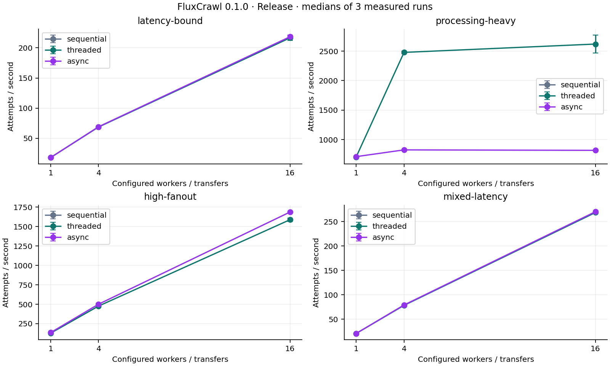
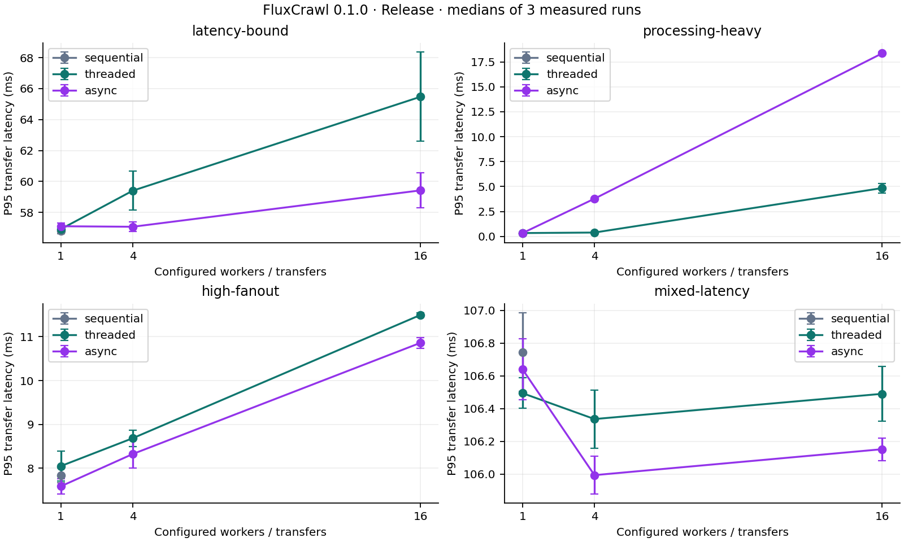
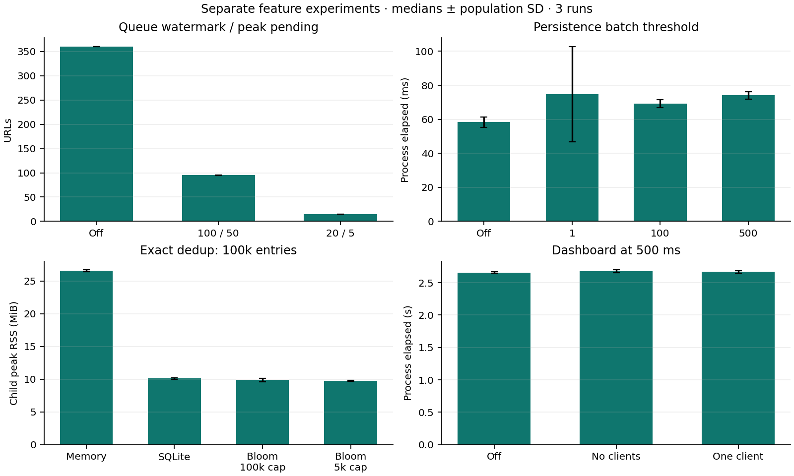
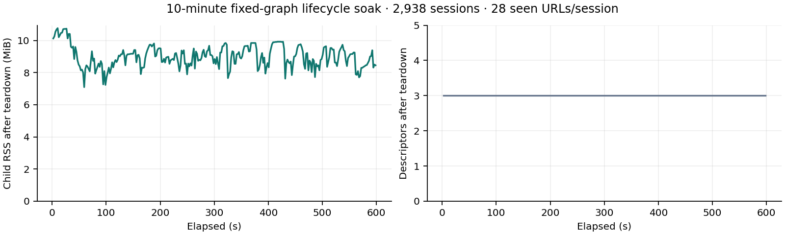

# FluxCrawl 0.1.0 benchmark certification

## Environment and protocol

Measured on macOS 15.0.1 / Darwin 24.0.0, Apple M3, arm64, 8 logical cores; Apple Clang 16.0.0, C++20 Release (`-O3 -DNDEBUG`), libcurl 8.7.1, SQLite 3.43.2 and libxml2 2.9.13. Fixture Python: 3.12.4.

Engine source revision at measurement: `d28b747`. Later commits add tests, reports and reproduction tools, not different engine behavior. [Full environment](benchmarks/0.1.0/environment.json) and [selected raw data](benchmarks/0.1.0/README.md) are tracked. Earlier exploratory runs during competing builds/tests were excluded; final experiments ran sequentially after those workloads finished. Background host activity/power state was not controlled.

All four base profiles use 100 logical pages on one loopback origin, depth 20, attempt budget 100, same-host filtering, MemoryExact, and no robots, retries, rate limit, persistence, dashboard or admission control. Each of seven engine/limit configurations has one excluded warmup and three measured runs: sequential/1; threaded and async at 1,4,16. All **84 measured samples**, plus warmups, passed the benchmark runner’s expected response/byte/count validation. No sanitized build was benchmarked.

| Profile | Fanout | Response delay | Body bytes | Extra shared anchors |
| --- | ---: | --- | ---: | ---: |
| latency-bound | 4 | 50 ms | 1024 | 0 |
| processing-heavy (`link-heavy`) | 99 | 0 ms | 65536 | 1000 |
| high-fanout | 99 | 5 ms | 4096 | 0 |
| mixed-latency | 99 | repeating 5,20,50,100 ms | 4096 | 0 |

Base elapsed time is `CrawlResult.elapsed`, not whole-process startup. P95 is the nearest-rank active-attempt duration over the entire 100-request run, not the dashboard’s recent window. Event-loop completion-observation delay can contribute to observed active duration; this is not pure wire RTT. Tables show medians across trials; elapsed CV is population SD / mean. Figure error bars are population SD across trials, not confidence intervals.

## Architecture results

### latency-bound

| Engine | Limit | Attempts/s | Elapsed ms | P95 ms | Elapsed CV |
| --- | ---: | ---: | ---: | ---: | ---: |
| sequential | 1 | 18.1 | 5510.0 | 56.79 | 0.6% |
| threaded | 1 | 18.2 | 5501.6 | 56.92 | 0.9% |
| threaded | 4 | 68.7 | 1454.6 | 59.40 | 0.7% |
| threaded | 16 | 216.5 | 461.8 | 65.47 | 1.9% |
| async | 1 | 18.2 | 5490.4 | 57.10 | 0.2% |
| async | 4 | 69.2 | 1446.0 | 57.07 | 0.2% |
| async | 16 | 218.3 | 458.0 | 59.42 | 1.2% |

### processing-heavy

| Engine | Limit | Attempts/s | Elapsed ms | P95 ms | Elapsed CV |
| --- | ---: | ---: | ---: | ---: | ---: |
| sequential | 1 | 704.9 | 141.9 | 0.34 | 0.5% |
| threaded | 1 | 706.2 | 141.6 | 0.34 | 1.7% |
| threaded | 4 | 2478.1 | 40.4 | 0.39 | 0.8% |
| threaded | 16 | 2619.4 | 38.2 | 4.85 | 6.1% |
| async | 1 | 711.3 | 140.6 | 0.33 | 2.2% |
| async | 4 | 825.9 | 121.1 | 3.78 | 1.1% |
| async | 16 | 818.2 | 122.2 | 18.36 | 0.2% |

### high-fanout

| Engine | Limit | Attempts/s | Elapsed ms | P95 ms | Elapsed CV |
| --- | ---: | ---: | ---: | ---: | ---: |
| sequential | 1 | 134.7 | 742.4 | 7.83 | 2.6% |
| threaded | 1 | 127.7 | 782.9 | 8.05 | 3.6% |
| threaded | 4 | 476.3 | 210.0 | 8.68 | 1.1% |
| threaded | 16 | 1588.4 | 63.0 | 11.50 | 1.5% |
| async | 1 | 135.3 | 739.0 | 7.59 | 2.6% |
| async | 4 | 500.4 | 199.9 | 8.32 | 1.6% |
| async | 16 | 1687.0 | 59.3 | 10.86 | 0.7% |

### mixed-latency

| Engine | Limit | Attempts/s | Elapsed ms | P95 ms | Elapsed CV |
| --- | ---: | ---: | ---: | ---: | ---: |
| sequential | 1 | 20.5 | 4875.5 | 106.75 | 0.4% |
| threaded | 1 | 20.5 | 4872.3 | 106.49 | 0.4% |
| threaded | 4 | 78.3 | 1277.8 | 106.34 | 0.7% |
| threaded | 16 | 268.9 | 371.9 | 106.49 | 0.2% |
| async | 1 | 20.5 | 4866.9 | 106.64 | 0.1% |
| async | 4 | 79.0 | 1265.8 | 105.99 | 0.2% |
| async | 16 | 270.5 | 369.6 | 106.15 | 0.4% |

The latency-bound profile improves with concurrency for both threaded and async execution. On processing-heavy input, threaded parsing scales well through four workers, while async plateaus because completion/extraction remains serialized on its crawl loop. This explanation follows the known architecture; the data are not a new profiler attribution of every cost. The higher-concurrency P95 reflects scheduling/observation costs as well as transport. Results do not establish a universal ranking for public websites.





## Historical regression context

The repository’s [Step 10 matched experiment](optimization-report.md) reports the same link-heavy preset after optimization at 700.4 attempts/s sequential, 2680.6 threaded/16 and 820.1 async/16. The present medians are approximately 704.9, 2619.4 and 818.2. There is no obvious order-of-magnitude regression in this comparable control. These runs are from different dates and repetition protocols; they are not a paired causal comparison. The Step 8 data do not provide a matched four-profile/limit CSV in the release tree, so no fabricated Step 8 speedup/regression percentage is reported. The selected current CSV is a reproducible baseline for future checks.

## Backpressure experiment

Separate async process trials use three origins, 12 branches × 30 leaves (**373 resources**), eight slots, max four per origin, no injected delay/retry/robots/persistence, and three runs per condition. Exact fixture sets/counts must match. Timing includes CLI startup and teardown; `/usr/bin/time` reports child peak RSS on this macOS host.

| High / low | Process ms | Attempts/s | Peak pending | Peak unfinished | Activations | Peak RSS MiB |
| --- | ---: | ---: | ---: | ---: | ---: | ---: |
| off | 26.7 | 13949 | 360 | 360 | 0 | 8.39 |
| 100 / 50 | 32.8 | 11378 | 95 | 100 | 6 | 8.77 |
| 20 / 5 | 29.6 | 12605 | 15 | 20 | 24 | 8.64 |

Tighter queues bound admitted work but force deferred-discovery disk I/O. The small workload does not establish a large-crawl memory saving from RSS alone. Separately, isolated stress passed the **10,021-URL** threaded/async robots+retry+SQLite workload with high=100, and **100,101 URLs** in Bloom+SQLite with high=1000 and a persistent restart. Logical sets, exact fetch counts, cache bounds and per-origin caps were asserted.

## Persistence batching

Separate async trials use four origins × 30 pages plus seed (**121 resources**), eight slots, max four per origin, 2 ms delay, MemoryExact and disabled admission. Three runs per configured mutation threshold, no warmups. The threshold is not a promise of one transaction per URL: coalescing and event-loop capture boundaries affect actual batch sizes.

| Batch threshold | Process ms | Attempts/s | Transactions | Avg mutations/batch | Commit ms |
| --- | ---: | ---: | ---: | ---: | ---: |
| off | 58.3 | 2074 | 0 | 0.0 | 0.0 |
| 1 | 74.8 | 1618 | 64 | 13.2 | 14.0 |
| 100 | 69.3 | 1747 | 6 | 141.0 | 3.4 |
| 500 | 74.0 | 1634 | 2 | 423.0 | 2.2 |

This short, delay-dominated process experiment has visible variation (especially the smallest threshold); it does not justify a universal optimal batch size. Durability and throughput trade off through commit frequency and the size of a potentially replayed suffix.

## Exact dedup and Bloom saturation

Synthetic native processes insert **100,000 identities** and test three 100,000-query mixes (95%, 20%, 50% absent), with three independent runs for MemoryExact, SQLiteExact, normally sized Bloom+SQLite and a 20× overfilled Bloom filter. Queries assert exact answers, including absent keys whose Bloom result is maybe. Timing below is for the 95%-absent mix; peak RSS covers the whole native process and all mixes/restoration. It is not total crawler memory.

| Backend / expected capacity | Peak RSS MiB | Lookup 100k ms | Exact DB checks | False positives | Restore ms | Bloom rebuild ms |
| --- | ---: | ---: | ---: | ---: | ---: | ---: |
| memory / 100000 | 26.58 | 14.3 | 0 | 0 | 0.0 | 0.0 |
| sqlite / 100000 | 10.11 | 289.8 | 100000 | 0 | 73.8 | 0.0 |
| bloom-sqlite / 100000 | 9.89 | 25.5 | 5906 | 906 | 146.6 | 73.9 |
| bloom-sqlite / 5000 | 9.77 | 237.3 | 100000 | 95000 | 148.7 | 75.0 |

At the configured 0.01 target and design capacity, Bloom avoids most negative DB membership checks. At 20× capacity the bitmap saturates and all 100,000 queries reach exact SQLite checks; correctness still holds. Its occupancy/inserted-capacity metrics expose this condition. MemoryExact remains the fastest membership choice here but retains every identity in RAM. No claim is made that SQLite eliminates retained crawl-record or host memory.

## Snapshot and SQLite startup

Synthetic states have 100 pending resources, with three runs each. These SQLite rows use MemoryExact restoration; the scalable SQLite/Bloom load/rebuild path is measured above. Times are not live-network replay duration.

| Seen | Snapshot bytes | Write ms | Snapshot load ms | SQLite total startup ms |
| --- | ---: | ---: | ---: | ---: |
| 1000 | 38851 | 2.1 | 1.4 | 2.2 |
| 10000 | 344957 | 18.0 | 13.1 | 12.8 |

## Observability overhead

The same 1529-attempt, three-origin fanout/retry workload was run in three repeats per condition. Final-state linger is zero for timing. Wall time includes process startup; `wait4` measures child user+system CPU time and peak RSS. The Python fixture/client and React/browser CPU are excluded. Topology/persistence are disabled.

| Mode | Interval ms | Process s | Attempts/s | CPU s | Peak RSS MiB | Received snapshots |
| --- | ---: | ---: | ---: | ---: | ---: | ---: |
| disabled | — | 2.656 | 575.7 | 0.298 | 10.92 | 0 |
| no-clients | 500 | 2.676 | 571.5 | 0.313 | 11.12 | 0 |
| client | 500 | 2.666 | 573.6 | 0.304 | 11.89 | 6 |
| client | 100 | 2.642 | 578.7 | 0.318 | 11.69 | 26 |
| client | 1000 | 2.669 | 572.9 | 0.297 | 11.70 | 3 |

Keep **500 ms**: it delivers useful two-updates-per-second feedback with fewer messages than 100 ms. The elapsed ranges overlap and differences are small relative to variation; no precise universal overhead percentage is claimed. CPU/RSS and payload/client bounds remain visible. This experiment certifies the existing default, not a new optimized interval.



## Ten-minute fixed-graph stability

The [certification report](certification.md) describes the paced, same-process lifecycle workload and earlier failures. The graph contains 28 logical seen URLs/session, including eight robots blocks; fetched set size stays 20. It completed 2938 sessions and 58,763 resource attempts, with descriptor count three after teardown. RSS fluctuations reflect allocator/OS behavior; the graph is evidence against sustained retained-resource growth on this workload, not a general leak proof.



## Reproduce

Build an unsanitized Release configuration first. Use new output directories; scripts never overwrite existing result sets. Run the measurement families sequentially after tests/builds finish.

```sh
python3 tools/certification_benchmarks.py --output certification-results/repro-base
python3 tools/certification_advanced.py --output certification-results/repro-advanced
python3 tools/observability_benchmark.py --repeats 3 > certification-results/repro-observability.jsonl
python3 tools/certification_plots.py certification-results/repro-base/samples.csv \
  --advanced certification-results/repro-advanced \
  --observability certification-results/repro-observability.jsonl
```

Plotting additionally requires matplotlib in the chosen Python environment. Native C++ builds do not require it or Node. Figures are standalone SVG/PNG generated from actual CSV/JSONL and were visually inspected; no dashboard screenshots are fabricated. All raw selected samples, not just favorable medians, are available under `docs/benchmarks/0.1.0/`.

Limitations: three measured trials per setting, a local Python HTTP fixture, one machine/compiler for timings, no controlled CPU power state, and no browser-rendering measurements. Short advanced trials include significant startup effects. Historical context is not a matched Step 8 regression experiment. Future comparisons should use the same committed profiles, flags, interpreter, hardware and measurement basis.
