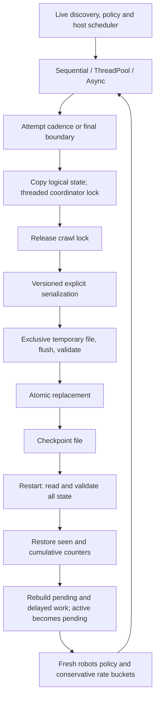

# Snapshot checkpointing and recovery

Step 17 uses format three for dedup configuration; formats one and two remain
readable as MemoryExact. Scalable SQLite membership cannot be exported as a
snapshot with a missing seen set; it requires its database. See
[dedup recovery](deduplication.md#recovery-and-compatibility).

Step 16 added format two: watermarks and append-only deferred-discovery companion
manifests. A recovery point with deferred work requires its referenced directory;
see [bounded-work recovery contract](backpressure.md#persistence-and-recovery).
The format-one layout below remains the historical readable format. New payloads
include the version-two pressure/spool fields after counters.

FluxCrawl checkpoints logical crawl state using snapshot semantics. Pending and
active resources are captured as unfinished work. Active network requests are not
preserved and may be reissued after resume, giving at-least-once request behavior
for work unfinished at the checkpoint boundary. There is no exactly-once GET or
continuous write-ahead logging claim.

## CLI and library API

```sh
./build/fluxcrawl --engine threaded --workers 8 --checkpoint crawl.chk \
  --checkpoint-every 100 --depth 5 --max-pages 10000 https://example.test
./build/fluxcrawl resume crawl.chk --engine async --concurrency 32
```

Normal crawl options add `--checkpoint FILE`, `--checkpoint-every N` (default 100,
positive resource-attempt count), and `--stop-after-attempts N`. The stop threshold
is an absolute cumulative attempt count, not additional attempts for this process.
It can stop gracefully before `max_pages`, leaving resumable work. CLI cadence/stop
options require a checkpoint destination; no checkpointing happens by default.

Resume reads the seed and configuration from the file. Only execution options
are accepted: engine, workers/concurrency, checkpoint destination, cadence and stop
threshold. Destination defaults to replacing the input checkpoint. Semantic flags,
a new seed, malformed numbers and engine-incompatible worker options are rejected.
An invalid/unreadable input fails startup rather than falling back to a new crawl.
Completed checkpoints return a message and issue no requests. A checkpoint with
an exhausted immutable page budget also returns a useful no-requests message;
it cannot finish remaining work without a separate new crawl/configuration policy.

There is no signal-specific graceful handler. Normal completion, page-budget stop
and configured graceful stop write a final snapshot. Fatal exceptions or abrupt
SIGINT/SIGTERM termination leave the last successfully replaced periodic snapshot.
No allocation, locking or file I/O runs in a signal handler.

Library callers use `CrawlOptions::checkpoint` (`CheckpointControl`) and
`resume_from`, a `shared_ptr<const CrawlCheckpoint>`. For resume, copy the saved
semantic options, set `resume_from`, select execution controls, and construct the
chosen engine with saved `HttpClientOptions`. Library restore also verifies seed,
semantic options and HTTP settings match, before issuing requests.

`CheckpointManager` provides `validate`, `serialize`, `deserialize`, `read`, and
`write`. The optional `before_replace` hook supports deterministic interruption
fault injection. `CheckpointControl::on_snapshot` observes a copied logical
snapshot outside the crawl lock; callbacks must not recursively invoke the same
runtime writer. Snapshots can also be built/serialized directly in offline code.

## Authoritative state and configuration

The format preserves:

- Seed URL and format/application versions.
- Semantic options: maximum depth/pages, same-host filtering, robots mode,
  host concurrency/rate/burst, retry allowance/backoff/multiplier/jitter.
- HTTP timeouts, redirect/body limits, User-Agent and environment-proxy mode.
- Canonical globally seen URL strings, including completed and blocked resources.
- Every unfinished resource's URL, depth, retry index, recovery flag, whether it
  was active, and optional already-computed retry eligibility deadline.
- Explicit cumulative resource, retry, policy, byte and unresolved-attempt counters.
- Snapshot sequence and completed marker.

It intentionally excludes response bodies, DOMs, easy/multi handles, sockets,
threads, active host counts, hash values/buckets, parser internals, parsed robots
policies, token timestamps, random-generator internals, historical request records,
latency samples and profiling timers. Output paths/callbacks, worker/concurrency
settings, profile enablement and graceful stop controls are execution state and
are not serialized.

Configuration in the file is authoritative. Engine/global execution capacity may
change; per-host politeness settings stay fixed. Environment-proxy mode is saved,
but external proxy environment contents, DNS/TLS/network state and server state
are not captured. This is local-process recovery, not cross-machine migration.

`CrawlState::seen_urls` exports logical URLs and `restore_seen` rebuilds the hash
set without rediscovering them. Restoring clears the constructor's staging seed;
only saved unfinished resources are requeued. Thus an already completed seed is
not refetched when a resumed child links back to it. Previously policy-blocked
URLs remain seen and finished even if a freshly fetched policy later changes.

## Format version one

No JSON dependency was introduced. The format is an ordered, labeled token stream
with newlines for inspection, unsigned decimal integers, finite decimal floating
values in the classic locale, and strings using standard C++ `std::quoted`
semantics. String delimiters are double quotes; backslash escapes the following
character. The writer escapes quotes and backslashes. It does not invent JSON
`\n`/Unicode escape semantics. URL fields must be quoted valid **canonical** HTTP(S)
URLs. Readers reject missing/reordered/extra fields and trailing data.

An excerpt from a real local checkpoint:

```text
FLUXCRAWL_CHECKPOINT 1
application "0.1.0-dev"
seed "http://127.0.0.1:61036/"
sequence 2
completed 0
crawl 3 100 0 0
retry 0 250 5000 2 1
host 0 0 0 0 0
http 5000 30000 10 8388608 1 "FluxCrawl/0.1.0-dev"
```

`crawl` contains depth, global page budget, same-host and robots flags. `retry`
contains maximum retries, initial/capped milliseconds, multiplier and jitter flag.
`host` contains cap-enabled/cap and rate-enabled/rate/burst, with disabled values
explicitly zero. `http` contains connect/request milliseconds, redirect limit,
body limit, proxy mode and quoted User-Agent. Named counter fields follow.

`seen COUNT` precedes sorted quoted URLs. `unfinished COUNT` precedes entries:

```text
work "http://example.test/path" DEPTH RETRY_COUNT RECOVERY WAS_ACTIVE HAS_DEADLINE UNIX_MS
END
```

The deadline is zero when absent. Ordering is logical queue order, not hash-map
iteration. HostKey is derived again from URL components; no independent host
identity can disagree with the URL. Version 1 limits files to 64 MiB and seen URLs
to one million. Exceeding limits is an explicit checkpoint error, not truncation.

Format version drives compatibility; application version is diagnostic. Formats
one, two and three are supported. Version one restores with admission disabled;
new writes use version three. New incompatible fields require a format version change. Validation checks bounds and invariants,
not cryptographic authenticity; snapshots are not an authenticated archive.

## Ready, delayed, held and active work

`HostScheduler::snapshot()` copies ready work in its pending-host rotation,
per-depth FIFO order, then delayed deadline order and active claim order. Active
metadata is retained separately from move-only leases only when snapshotting is
enabled, so moving a lease's payload into HTTP processing cannot lose the URL.
Exporting active state without tracking is an explicit error.

`CrawlPolicy::snapshot()` copies normal resources held behind policy bootstrap.
Bootstrap requests themselves are excluded from unfinished resource state because
policy acquisition restarts Unknown. Resources and their retry deadlines remain
recoverable while bootstrap is active or backing off.

On restore, unfinished work is stably ordered by depth before policy acceptance.
This ensures the first bootstrap for an origin uses its shallowest held depth,
including when a deeper queued item preceded an active shallower item in the
snapshot. Host queues, fairness structures and maps are rebuilt; exact previous
round-robin position and concurrent completion ordering are not promised.
Active host/global counters begin at zero. Formerly active resources become
ordinary pending work with the same depth/retry index and a recovery tag.

All restored work goes through ordinary policy admission and host scheduling,
including recovered requests and due retries. It cannot bypass global slots,
host caps, rate tokens, depth barriers or the remaining page-attempt budget.

## Attempt and result accounting

A reserved request/setup attempt already counted before the snapshot remains
counted, even if its outcome is unknown. Reissuing it consumes another attempt.
`attempts_unresolved` records prior reserved resource attempts without a saved
published outcome; infrastructure has `robots_attempts_unresolved`. These are
cumulative known-lost outcomes, not currently active counts.

`recovery_attempts` counts actual recovery reservations. Reissuing a policy retry
keeps its retry index; `recovery_retry_attempts` distinguishes this extra reservation
from a newly scheduled retry. Thus recovery can produce more total attempts than
`1 + max_retries` without resetting/expanding the policy retry allowance. The
immutable global page budget still bounds cumulative saved/resumed reservations.

At snapshot/return:

```text
pages_attempted = responses_received + fetch_failures + attempts_unresolved
resources_completed + urls_blocked_by_robots + robots_resources_reused
    + urls_pending = urls_discovered
retries_cancelled = retries_scheduled + recovery_retry_attempts - retries_attempted
```

`retries_cancelled` means scheduled but unexecuted at this stop/snapshot. Resource
retries can execute after resume, so that backlog count can decrease. Reacquired
robots may deny formerly admitted unfinished work; its unexecuted retry remains
accounted without a network attempt. Robots bootstrap retry plans restart with
fresh Unknown policy; their old unexecuted plans are not replayed as resources.
Cumulative robots admission/cache-hit/origin-operation counters may include fresh
policy evaluations across sessions.

Counters are restored, but `records` and `robots_records` contain only newly
published records in this process. They need not equal cumulative attempt counts.
Elapsed/profiling/latency samples start fresh. Throughput uses session-start counter
baselines, avoiding division of historical counts by this process's elapsed time.
Checkpoint count, last file bytes and I/O duration are separate session metrics.
Async snapshot pauses are excluded from request latency samples; they remain
part of operational elapsed time. Threaded file I/O is outside frontier/network
processing timers. Checkpoint runs are not baseline benchmark experiments.

**Snapshot boundary limitation:** work completed after the last durable snapshot
can be repeated. Reservations made after that snapshot may also be absent from
saved counters. Without a WAL, aggregate physical traffic across crashed processes
cannot be counted exactly from an older snapshot. `--checkpoint-every 1` narrows
this window but is not an exactly-once or universal durability guarantee.

## Retry clocks, rate buckets and robots freshness

Chosen resource retry deadlines are converted at capture:

```text
remaining = max(0, steady_deadline - steady_now)
unix_deadline_ms = wall_now_ms + ceil(remaining_in_ms)
```

Restore computes `max(0, unix_deadline_ms - wall_now_ms)` and adds it to a new
steady time. Downtime therefore counts; expired retries are immediately eligible,
future retries stay delayed. Large values saturate rather than overflow. No raw
steady-clock epoch is serialized. Millisecond rounding and wall-clock adjustments
(NTP/manual/VM) can shorten or lengthen the reconstructed wait. After restoration,
normal runtime waits again use only steady time. Already-chosen jitter is preserved
by the deadline; future retry decisions may use fresh RNG state.

Rate configuration is saved, but token history is not. Restored schedulers create
host buckets empty and refill normally from creation time, including before robots
bootstrap. This can impose an extra initial wait and avoids granting a new startup
burst. Counts restart at zero because no old network connection can be restored.
Server-side work from the crashed client may still be running temporarily; caps
are local to the new process and cannot migrate remote execution state.

Parsed robots caches reset Unknown. Unfinished origins reacquire policy through
normal host scheduling/retry handling before resource requests launch. Previously
blocked/completed resources are not reconstructed merely to reconsider policy.
Partial bootstrap bodies/handles are discarded. Policy can have changed while the
crawler was down, so the resumed reachable remainder can legitimately differ.

## Architecture



## Consistency and write ordering

Threaded capture copies seen URLs, ready/delayed/active resources, held-policy work
and aggregates under the coordinator mutex at a coherent boundary. It releases
that mutex before serialization, callbacks, opening/writing, flush, fsync or rename.
An independent writer mutex serializes replacements. Snapshot sequences prevent an
older copy delayed behind another worker from overwriting newer state. Final capture
runs after workers join and replaces any earlier periodic state.

Async capture occurs at event-loop boundaries after filling/draining transfers;
no curl internals are serialized. Sequential capture occurs after publication and
lease release. Configured graceful stops cease new reservations and drain existing
claims before final capture. No checkpoint thread or timer thread was introduced.

Copying costs O(seen + unfinished), plus sorting for deterministic serialized sets
and held work. Full snapshots and read-back validation deliberately favor correctness
over throughput. Serialization can allocate an additional bounded full text buffer;
this is not a scalable live-storage implementation.

## Atomic replacement and failure behavior

1. Validate and serialize the copied model.
2. Create an exclusive uniquely named temporary file beside the destination.
3. Write all bytes, check flush, fsync the file on POSIX, and check close.
4. Re-read and fully validate the actual temporary bytes.
5. Rename/replace the primary through `std::filesystem`, without shell commands.

Caught pre-replacement failures clean up only the owned temporary file and leave
the previous primary intact. A crash can leave an orphan temporary file; readers
ignore it and read only the primary. No automatic promotion of a partial `.tmp`
file occurs. Temporary files use exclusive creation and never truncate a collision.

Same-directory atomic rename on supported local filesystems provides old-or-new
replacement, not universal power-loss durability. Directory entries are not fsynced;
filesystem, OS and storage behavior still matter. Non-POSIX builds use checked
flush/close without the POSIX fsync step. A platform/filesystem replacement failure
is reported rather than silently deleting/recreating the old primary.

Only one process should own a checkpoint destination. Runtime locks order writers
within one crawl, not independent processes or machines. There is no distributed
lock, live database, incremental log, backup rotation or cross-machine recovery.

Periodic/final write failures print a diagnostic, accumulate session errors and
allow healthy crawling to continue. The CLI exits nonzero if a write failed, even
if crawling otherwise succeeded. Invalid resume input fails before any request;
there is no silent restart. Load checks version, exact fields, numeric bounds,
canonical URLs, duplicate seen/unfinished entries, pending membership, depth,
retry allowance, same-host semantics, page-budget and accounting/completion
invariants. Live state is never partially restored from invalid input.

## Verification and local demonstration

The unchanged Step 13 baseline passed **58/58** tests before implementation.
The final normal suite passed **61/61** in 47.87 seconds; Release builds succeed.
ASan/UBSan passed **61/61** in 60.77 seconds with no findings. TSan passed all
five selected checkpoint/shared-concurrency suites in 76.21 seconds, with no
findings. Sanitizer timings are not performance evidence.

`core.checkpoint` covers deterministic round trips with several origins,
ready/delayed/active state, HTTP string escaping, version rejection, truncation,
malformed/negative/overflow fields, invalid URLs/depth/retry counts, duplicate or
unknown pending entries, atomic replacement with injected pre-rename failure,
file errors, future/expired/saturated clock conversion, cold buckets, in-flight
metadata after payload moves, restored dedup, recovery budget charges, session
throughput and shallow bootstrap restoration.

`checkpoint.integration` compares against a fresh uninterrupted reference and
checks sequential -> async, threaded -> async and async -> threaded continuation.
It also resumes intermediate active snapshots, verifies completed root/backlink
dedup, depth-three children, preserved retry-two deadlines, exactly two remaining
attempts from an eight-of-ten budget, multi-origin limits, robots reacquisition
without refetching a previously blocked URL, and async latency isolation using an
injected snapshot pause. Fresh driver processes reconstruct each session.

`cli.checkpoint` tests execution/semantic validation, graceful stop/resume,
completed markers, corrupt/unreadable startup, continued crawling after checkpoint
write failure, and abruptly terminates a threaded process after a periodic file
exists before resuming with async. Baseline benchmark configuration rejects
checkpointing/resume; its existing workload/CSV tests still pass.

A manual Release demonstration used a local three-origin fixture with a threaded
8-worker crawl, cadence two, depth three and page budget 100. After a primary file
existed, the process was terminated and the first fields were inspected (excerpt
above). Async resume with concurrency 16 completed with:

```text
Pages attempted: 14
Responses: 11
Fetch failures: 0
URLs discovered: 11
URLs pending: 0
Recovery attempts: 3
Unresolved prior attempts: 3
Checkpoints written: 1
Checkpoint bytes: 1242
Exit status: 0
```

The already completed root was requested exactly once. The inspected file contained
four unfinished entries and no pointers, binary dumps, bodies or runtime handles.
All test/manual traffic stayed on loopback. Snapshot files, temporary writes,
server data and sanitizer artifacts were not added to Git.

```sh
cmake -S . -B build
cmake --build build -j 4
ctest --test-dir build --output-on-failure
cmake -S . -B build-release -DCMAKE_BUILD_TYPE=Release
cmake --build build-release -j 4
cmake -S . -B build-sanitize -DCMAKE_BUILD_TYPE=Debug \
  -DCMAKE_CXX_FLAGS='-fsanitize=address,undefined -fno-omit-frame-pointer' \
  -DCMAKE_EXE_LINKER_FLAGS='-fsanitize=address,undefined'
cmake --build build-sanitize -j 4
ASAN_OPTIONS=halt_on_error=1 UBSAN_OPTIONS=halt_on_error=1 \
  ctest --test-dir build-sanitize --output-on-failure
cmake -S . -B build-tsan -DCMAKE_BUILD_TYPE=Debug \
  -DCMAKE_CXX_FLAGS='-fsanitize=thread -fno-omit-frame-pointer' \
  -DCMAKE_EXE_LINKER_FLAGS='-fsanitize=thread'
cmake --build build-tsan -j 4
TSAN_OPTIONS=halt_on_error=1 ctest --test-dir build-tsan \
  -R 'core.checkpoint|checkpoint.integration|cli.checkpoint|core.thread_pool_crawler|core.host_scheduler' \
  --output-on-failure
```

## Before scalable persistent storage

Preserve the distinction between discovery, unfinished work, reservations and
published outcomes when moving to incremental storage. Transaction ordering or a
WAL is needed to shrink the uncheckpointed suffix; a database alone does not
provide exactly-once HTTP behavior. Measure snapshot size/copy/sort/I/O costs before
replacing the full-snapshot design. Policy freshness, single-writer ownership,
clock conversion, immutable semantics and format migrations need explicit designs.
No SQLite live storage, Bloom filter, distributed crawling, frontend, HTTP cache,
sitemap discovery or continuous WAL was added in this phase.
