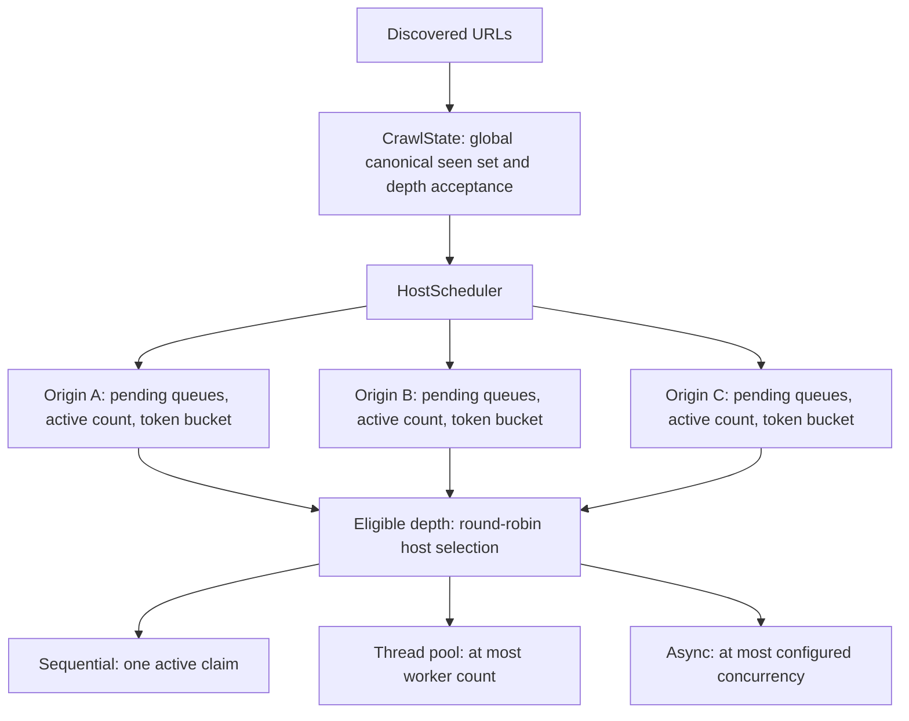

# Host scheduling and rate limiting

FluxCrawl shares one `HostScheduler` policy across sequential, threaded and async
crawls. Defaults are unlimited per-origin concurrency relative to the engine's
global limit, and disabled rate limiting. Fair selection is always enabled.
This preserves complete logical crawl results with limits disabled; ordering
across origins, and therefore truncated subsets, can differ from global FIFO.

```sh
./build/fluxcrawl --engine async --concurrency 32 \
  --max-per-host 4 --rate-per-host 10 --burst-per-host 1 \
  --depth 3 --max-pages 500 https://example.com
```

Omit `--max-per-host` for no additional cap; omit `--rate-per-host` to disable the
bucket. There is no magic numeric unlimited value. Positive finite fractional
rates are accepted. Burst defaults to one and may be specified before or after
the rate; explicitly supplying burst without rate is rejected. Zero/negative
caps, zero/negative/nonfinite rates, zero burst, overflow, and trailing numeric
junk are rejected. Library callers use `CrawlOptions::scheduling`:

```cpp
options.scheduling.max_per_host = 2;
options.scheduling.rate = fluxcrawl::RateLimit{5.0, 1};
// Reset either optional to disable that policy independently.
```

## Identity, policy and mechanism

`HostKey::from(Url)` copies normalized scheme, normalized hostname and effective
port. Equality and hashing use all three. HTTPS omitted port and explicit 443
are equal; HTTPS 8443 and HTTP 443 are different origins. IPv6 uses the existing
normalized bracketed host component. No URL strings are split manually. This is
origin identity, not a DNS-address or registrable-domain grouping: aliases that
reach the same server may have independent quotas.

`--same-host` remains discovery filtering by hostname only, as before. Ports and
schemes do not affect that filter; accepted URLs are scheduled by origin.



Mechanism is queue storage, active counters, leases, tokens and deadline waits.
Policy is round-robin selection, depth barriers, configured caps, rate and burst.
The scheduler does not fetch, parse, deduplicate, or own a thread.

`CrawlState` keeps the one global seen set. Accepted discoveries pass through its
FIFO staging queue to `schedule_pending(HostScheduler&)`; after publication this
staging queue is empty. Pending counts returned by crawls come from host queues.
A pending, active, or rate-limited URL remains globally seen.

The scheduler holds `unordered_map<HostKey, Host, HostKeyHash>`, with per-host
`map<depth, deque<CrawlItem>>` storage. A list contains only hosts with pending
work, and a depth-count map identifies the earliest pending level. Host nodes
persist for the crawl, so idle hosts retain depleted token buckets. List pointers
refer to map nodes, whose addresses survive rehash; nodes are never erased.

Each acquisition examines at most one round of the pending-host list. Examined
hosts rotate to the tail without allocation. Full, rate-limited and wrong-depth
hosts are skipped; eligible hosts yield one FIFO item. Empty hosts leave the
list. Thus a large host queue cannot starve another eligible host at the current
depth. This is fairness of admission opportunities, not equal throughput or
completion order. The implementation scans pending ineligible hosts, but never
thousands of retained empty hosts. It deliberately avoids a timer heap or
weighted scheduling tree.

## API and ownership

The public scheduler API is `enqueue(CrawlItem)`, `acquire(steady_time)`,
`next_deadline(steady_time)`, `pending()` and `active()`. Construction receives
the engine global limit and `SchedulingOptions`. The scheduler is noncopyable
and must outlive its leases. It has no internal mutex: callers must serialize
all operations, including lease release/destruction.

`acquire` atomically checks global capacity, host capacity, the current depth,
and tokens, then returns an optional move-only `Lease` containing the crawl
item. A successful claim increments host/global activity and consumes one token.
`Lease::release()` is idempotent; destruction also releases. No token is refunded
for an attempted setup failure. Moves transfer ownership without allocation.

The active interval conservatively extends from claim through HTTP work,
processing and publication. The per-origin network concurrency therefore cannot
exceed the claim cap, although some slots can be occupied by parsing. The global
limit is one for sequential, workers for threaded, and transfer concurrency for
async. Both global and per-origin constraints apply independently.

Sequential leases release at iteration exit, including exception unwinding.
Threaded claims, publication, release, fatal cleanup and token state share the
coordinator mutex. Worker exceptions release the retained claim under that mutex,
notify waiters, join the pool and rethrow. Async transfers own leases; completion,
setup failure and fatal unwinding release them after processing. Multi-handle
cleanup detaches easy handles before transfer destruction. HTTP errors, 404/500,
body-limit failures and transport failures all release their slots.

## Tokens and deadlines

A configured bucket starts with `burst` tokens. At evaluation time it lazily
refills `min(burst, tokens + elapsed_seconds * requests_per_second)` using
`steady_clock`, and admission consumes one token. There are no timer threads.
Disabled buckets bypass token logic. Time is explicit in the API so unit tests
advance virtual time without sleeping. Production clocks are monotonic.

With fewer than one token, eligibility is `now + (1 - tokens) / rate`, rounded
up to a clock tick. Extreme small valid rates saturate the deadline at the clock's
maximum instead of overflowing the duration conversion. `next_deadline` takes
the earliest token deadline among depth-eligible hosts with capacity. Full hosts
need a completion notification, not a timer. It may return `now` if a token became
available between acquisition and deadline calculation, preventing a lost wakeup.

The token envelope permits an initial burst plus sustained rate, not a strict
sliding-window count. For example, rate 5/burst 1 can admit immediately, then
approximately every 200 ms. Rate 1/burst 4 can admit four initially only if both
concurrency limits also allow it. Rate limits control admission just before
request setup, not exact socket-send or server-arrival timestamps; OS scheduling,
DNS, setup and event-loop work may delay actual starts. Server timestamps are
therefore checked with broad tolerance, while bucket arithmetic is tested exactly.

Threaded workers call `condition_variable::wait_until` for the next deadline,
or ordinary `wait` when only completion/discovery can unblock work. Both release
the mutex. Every wake rechecks fatal state, budget, queues, tokens and capacity.
No worker sleeps while holding the coordinator lock.

Async fills eligible slots before polling and again after draining completions.
With active transfers, the poll timeout is bounded by the next token deadline
and the existing 1000 ms maximum; libcurl can wake earlier. With pending work and
no active transfers, it sleeps until the deadline, then refills. Sequential uses
the same deadline while it has no active claim. No arbitrary periodic sleep or
separate scheduler thread is used.

## Correctness boundaries

Natural termination requires no pending **and** no active work. Temporarily
ineligible queues remain pending. The page budget is checked before acquisition;
only claims consume attempts. At budget exhaustion existing claims finish and
publish discoveries, and pending work is reported. A zero budget leaves the seed
pending without any fetch.

Only the shallowest pending depth is eligible, and a deeper depth waits for all
active claims at the preceding depth. This preserves shortest first discovery
under the existing crawler's breadth-first expansion. Fairness applies within
that barrier; a rate-limited shallow host may intentionally delay deeper work.
Direct scheduler clients must enqueue work consistent with this breadth-first
protocol; the scheduler is not a general arbitrary-priority executor.

**Redirect limitation:** accounting belongs to the original requested origin
for the complete logical attempt. Cross-origin redirects may contact another
origin without charging its bucket/cap. No redirect-aware slot migration or
per-hop politeness guarantee is claimed. Existing redirect, TLS, compression,
body-limit and timeout policy is unchanged.

Step 12 adds optional retries without passing them through discovery dedup.
Delayed retries count as pending and contribute to wake deadlines; due retries
re-enter ordinary host scheduling with fresh leases and tokens. The previous
lease releases before any backoff wait. See [retry semantics](retries.md) for
attempt budgets, cancellation, response classification and timing behavior.

## Benchmark compatibility and reproduction

The existing `fluxcrawl benchmark` CLI does not accept politeness options, and
`BenchmarkRunner` rejects library configurations containing host caps or rates
before contacting the fixture. Its existing CSV schema therefore continues to
represent disabled limits. No old baseline was overwritten and no new speedup
claim is made for this scheduling feature.

The separate optional multi-origin scenario runs the ordinary crawl CLI. Its CSV
records global concurrency, origin/page counts, delay, cap, rate, burst, per-origin
and global server activity, first-start indices, and arrival spans. Each trial
validates every expected request exactly once and checks the cap/rate envelope.
Trials use fresh origins and discard warmups. CSV creation is exclusive and occurs
only after validation. It reports **whole client-process wall time**, including
startup, not the internal latency/elapsed metrics of the original benchmark.
Use Release builds for timing and do not combine these measurements with Step 10.

```sh
cmake -S . -B build-release -DCMAKE_BUILD_TYPE=Release
cmake --build build-release
python3 tools/scheduling_benchmark.py --engine all --origins 4 \
  --pages-per-origin 100 --concurrency 12 --max-per-host 2 \
  --runs 3 --warmups 1 --output results/step11-multi-origin.csv
python3 tools/scheduling_benchmark.py --engine all --origins 2 \
  --pages-per-origin 3 --delay-ms 0 --concurrency 8 --max-per-host 2 \
  --rate-per-host 10 --burst-per-host 1 --runs 3 --warmups 1 \
  --output results/step11-rate.csv
```

Both commands create local servers automatically. No public server is used to
test aggressive concurrency. Raw CSV/request data stays in ignored `results/`.

## Verification (2026-10-24)

The clean Step 10 baseline passed 46/46 tests before implementation. The final
normal build passes 50/50 tests, including the four new suites. Standard and
Release builds both succeed. ASan/UBSan passed the 47 non-snapshot cases; three
existing CLI snapshots needed the new policy-summary lines, then all three passed
on rerun. No sanitizer findings. ThreadSanitizer passed all six selected suites,
including multi-origin integration and stress (124.46 seconds total). Sanitizer
timing is not used as performance evidence.

Coverage includes:

- HostKey normalization, default/nondefault ports, scheme separation and IPv6.
- Exact fake-time burst consumption, partial/full refill, capacity cap, disabled
  buckets, invalid rates, tiny/huge finite rates and deadline saturation.
- Empty scheduler, global/host caps, release and move ownership, 1,000-item host
  plus small hosts, retained tokens after empty queues, global seen identity,
  depth barriers, pending-with-zero-active state and deadline-boundary wakeups.
- All three engines with caps/rates enabled and disabled, exact URL/depth sets,
  shortest-path depth races, same-host filtering across different ports, zero/
  one/five-attempt budgets, 404/500, transport close, body limit and redirect.
- Threaded/async single-origin saturation at exactly three active requests;
  four-origin cap two with global activity eight; a 100-URL slow origin plus
  a two-URL fast origin starting before the large queue drains.
- Eight origins × 100 URLs plus the seed: **801 unique attempts**, no duplicates,
  per-origin peak **4**, global peak **32** for both threaded and async. A separate
  37-attempt run stops at exactly **37**, reports **764 pending**, and preserves
  both caps. The same stress checks pass under TSan. Normal stress takes about
  1.09 seconds on this host and is labeled `stress` for selective CI runs.
- Rate 10/burst 1 with zero server delay: three requests on each of two origins,
  plus the seed. Normal integration arrival spans were 0.312–0.315 seconds for
  the seed origin's four requests and 0.209–0.211 seconds for the other's three.
  All engines resume after pending work becomes temporarily ineligible.
- CLI invalid numbers, defaults, option ordering, all engine choices and legacy
  benchmark rejection. Existing benchmark/profiling equivalence tests still pass.

Commands executed:

```sh
cmake -S . -B build
cmake --build build -j 4
ctest --test-dir build --output-on-failure
cmake -S . -B build-release -DCMAKE_BUILD_TYPE=Release
cmake --build build-release -j 4
cmake -S . -B build-sanitize -DCMAKE_BUILD_TYPE=Debug \
  -DCMAKE_CXX_FLAGS='-fsanitize=address,undefined -fno-omit-frame-pointer' \
  -DCMAKE_EXE_LINKER_FLAGS='-fsanitize=address,undefined'
cmake --build build-sanitize -j 4
ASAN_OPTIONS=halt_on_error=1 UBSAN_OPTIONS=halt_on_error=1 \
  ctest --test-dir build-sanitize --output-on-failure
# After correcting the three existing CLI output snapshots:
ASAN_OPTIONS=halt_on_error=1 UBSAN_OPTIONS=halt_on_error=1 \
  ctest --test-dir build-sanitize --rerun-failed --output-on-failure
cmake -S . -B build-tsan -DCMAKE_BUILD_TYPE=Debug \
  -DCMAKE_CXX_FLAGS='-fsanitize=thread -fno-omit-frame-pointer' \
  -DCMAKE_EXE_LINKER_FLAGS='-fsanitize=thread'
cmake --build build-tsan -j 4
TSAN_OPTIONS=halt_on_error=1 ctest --test-dir build-tsan \
  -R 'core.host_scheduler|core.thread_pool_crawler|core.profiling|benchmark.integration|scheduling.integration|scheduling.stress' \
  --output-on-failure
```

### Manual Release CLI results

The two reproduction commands above were executed on the same Apple M3/macOS
host used for Step 10. Each configuration has three measured runs and one
discarded warmup, all with full fixture validation. These demonstrate scheduling
behavior, not a performance improvement over the earlier architecture.

Four origins, 100 pages each plus the seed, 20 ms server delay, global limit 12,
per-origin cap two, rate disabled:

| Engine | Requests per run | Global peak | Per-origin peaks | Median process elapsed ms | Elapsed population stddev ms |
| --- | ---: | ---: | --- | ---: | ---: |
| sequential | 401 | 1 | 1;1;1;1 | 10221.429 | 107.509 |
| threaded | 401 | 8 | 2;2;2;2 | 1349.181 | 17.814 |
| async | 401 | 8 | 2;2;2;2 | 1309.282 | 17.128 |

Two origins, three pages each plus the seed, zero delay, global limit eight,
per-origin cap two, rate 10/sec, burst one:

| Engine | Requests per run | Seed-origin arrival span ms (range) | Other-origin arrival span ms (range) |
| --- | ---: | --- | --- |
| sequential | 7 | 309.690–311.381 | 207.304–210.416 |
| threaded | 7 | 307.711–311.782 | 206.537–208.977 |
| async | 7 | 306.945–314.509 | 206.226–209.935 |

Every run completed without duplicate requests, cap violations or missing work.
The seed origin has four requests, so its three paced intervals span roughly
300 ms; the other origin has three requests and two intervals spanning roughly
200 ms. This checks resumption from pending-but-rate-limited state at server
arrival level; exact refill and burst semantics are covered by virtual-time tests.
Raw CSVs remain ignored in `results/step11-multi-origin.csv` and
`results/step11-rate.csv`. No public-host traffic or performance thresholds were
added to CI.
