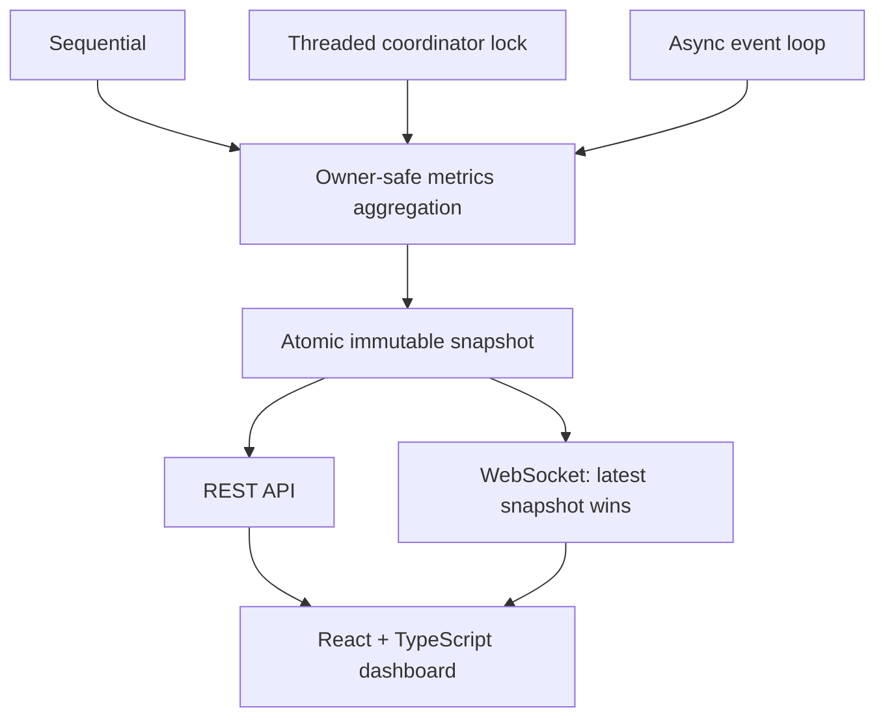

# Live observability (Step 18)

FluxCrawl's observability layer answers what the crawler is doing now. It is a
local, read-only systems console, independent of profiling and crawler correctness.
There are no accounts, remote controls, distributed workers, or page rendering.



## Build and run

C++20, libcurl, libxml2, SQLite and Threads remain the core dependencies. The
optional server uses Boost >= 1.81 (Beast/Asio and Boost.JSON), found with CMake's
Boost config package. There is no downloaded C++ dependency and no raw-socket HTTP
implementation. Build assets once; Node is not needed to run the C++ application.

```sh
cmake -S . -B build
cmake --build build -j 4
cd dashboard
npm ci
npm run typecheck
npm run build
cd ..
./build/fluxcrawl --engine async --concurrency 32 --max-per-host 4 \
  --dashboard --dashboard-port 8080 --metrics-interval-ms 500 \
  --dashboard-topology https://example.test/
```

The CLI prints `Dashboard: http://127.0.0.1:8080`. Open that address in a browser.
An occupied port fails clearly; `--dashboard-port 0` prints an OS-assigned port.
The server always binds IPv4 loopback. There is no external-bind option, CORS
wildcard, mutation API, or telemetry-driven scheduling dependency. Unexpected
Origin headers are rejected; responses include a same-origin content policy.

`--dashboard-linger-ms 2000` is the default final-state grace period. It can be
0..60000; process exit remains automatic. Final state is `completed` for an
exhausted frontier, `stopped` for a page/stop budget, or `error` for persistence
errors. Exceptions caught by the CLI publish an error snapshot based on the last
safe sample before the grace period. After process exit the browser reports
Disconnected and preserves its last counters, charts, and backend state.

Without `--dashboard` there is no server, sampler thread, recent latency/rate
buffer, or topology collector. Build with
`-DFLUXCRAWL_OBSERVABILITY=OFF` to omit the server and Boost dependency entirely.
`resume` and `benchmark` retain their existing CLI; dashboard flags currently
apply to fresh crawls. Library callers can attach `CrawlOptions::observability`
to a resumed engine invocation; telemetry itself is never persisted.

Vite development mode uses `npm run dev` from `dashboard/`, proxying `/api` and
`/ws` to port 8080. The C++ server otherwise serves `dashboard/dist` from the
configured source checkout. A missing asset build returns HTTP 503 with build
instructions; the API and stream remain usable. Library embedders can pass a
separate asset directory to `ObservabilityServer`.

## Ownership and sampling

`Observability` builds `ObservabilitySnapshot` from existing `CrawlResult`,
`CrawlState`, `HostScheduler`, and policy counters. It copies counters, not
`CrawlResult::records`, response bodies, or checkpoint work lists. Only the engine
owner mutates aggregation state. Threaded callers use the existing coordinator
mutex; sequential sampling uses a small mutex released throughout blocking fetch
and HTML processing. Both sampler threads wake promptly and join before their
referenced crawl state is destroyed. Async captures stay on the event loop, with
poll and delayed-work waits capped by the sampling interval. No server operation
locks the scheduler or reaches into crawler containers.

Snapshots are published as `shared_ptr<const ObservabilitySnapshot>` using atomic
shared-pointer operations supported by the installed Apple C++ library. Serialization
and network work happen on a separate single-threaded I/O context. Counters are
never copied under a server lock. Engine operations check capture deadlines, and
a final capture bypasses the deadline. Expensive HTML/discovery/persistence work
can delay publication: this is sampled telemetry, not a hard real-time guarantee.

Default sampling is **500 ms**, configurable with `--metrics-interval-ms` in
100..10000 ms. See the measurement report for the experiment and its limitations.

## Stable wire contract

Every REST response and snapshot data object has `schema_version: 1`. Counts are
JSON numbers (JavaScript precision is limited beyond 2^53). Missing latency and
rate limits are `null`, not invented zeros. Engine-specific fields are omitted
when meaningless, and the Bloom object exists only for Bloom+SQLite.

| Endpoint | Response |
| --- | --- |
| `GET /api/status` | State, running flag, engine, elapsed time, sequence, bounded server diagnostics |
| `GET /api/metrics` | Complete latest operational snapshot |
| `GET /api/hosts` | Total origin count, sample description, capped host rows |
| `GET /api/topology` | Explicit enabled flag, node/edge caps, sampled origin graph |
| `GET /ws` | RFC6455 WebSocket upgrade; periodic JSON snapshots |
| `GET /` and `/assets/<name>` | Built dashboard and flat Vite assets |

WebSocket messages have this shape:

```json
{"type":"snapshot","timestamp_ms":1234.5,"data":{"schema_version":1,"sequence":3}}
```

`timestamp_ms` is elapsed monotonic session time at capture; the example omits
other data fields. Clients may receive repeated sequences when the engine hasn't
published a newer snapshot. The dashboard ignores duplicate sequences. No
per-byte events or unbounded backend time series are retained.

### Metrics and their meaning

| Category | Fields / semantics |
| --- | --- |
| Progress | Logical URLs seen; pending admitted resource URLs; active scheduler claims including robots; completed logical resources; robots blocks; resource attempts; all HTTP responses; fetch failures. Successful 2xx responses are counted separately for the current session. Deferred disk discoveries are separate from logical seen/pending. |
| Throughput | Resource **attempt completions** per second, rolling five seconds and current-session overall average. Robots infrastructure is excluded. Retries count as attempts. The rolling denominator is elapsed session time until five seconds. |
| Latency | Nearest-rank P50/P95/P99 and mean for resource attempts within five seconds, capped at the newest 4096. Transfer duration excludes queue wait. Empty samples are null. No overall-history sort is performed. |
| Threaded | Configured, active and idle workers (active means a leased request), peak active, wait count, accumulated coordinator-lock wait. Worker histories and arbitrary profiler timers are excluded. |
| Async | Configured concurrency, active and peak transfers, loop iterations, accumulated poll wait, transfer completions including robots. Active/configured gives utilization. |
| Hosts | Origin, pending (including delayed), active, per-host limit, token rate/burst, rate eligibility wait, delayed work, terminal resources. Completed includes blocked resources; policy-held pending is reported separately. |
| Queues / pressure | Scheduler/policy pending, delayed retries, robots-held resources, disk-deferred discoveries; enabled/active pressure, high/low watermarks, pending peak, activations, elapsed time under pressure. The gate measures unfinished admitted resources, so it can engage below the pending high watermark while requests are active. |
| Retry | Resource retries scheduled/attempted/exhausted/recovered; delayed scheduler queue includes robots; next retry delay is relative to snapshot capture. |
| Robots | Fetches, cache hits, blocked resources, failures, held URLs and hosts waiting for policy. Held URL/host gauges are maintained incrementally. |
| Exact dedup | Backend, seen entries, confirmed duplicate discoveries, lookup time, exact DB membership queries. Counters come directly from the selected seen backend. |
| Bloom | Bytes, bit occupancy, target FP, inserted/design capacity, definite negatives, maybe hits, false positives and exact checks. Observed FP = false positives / (definite negatives + false positives), or null without negative membership observations. This differs from the fraction of maybe hits that were false. |
| Persistence | Off/snapshot/SQLite; transactions, current journal mutations awaiting batching, average mutations per transaction, total and last commit duration, DB bytes refreshed at final commit. No periodic filesystem stat. |
| Checkpoints | Writes, last size, total I/O duration, last successful duration and wall-clock completion timestamp. |
| Errors | Last 16 resource fetch / HTTP 5xx / retry-exhaustion summaries plus up to four recent errors per persistence backend; messages capped at 160 characters, without response bodies or request queries. |

The schema and TypeScript interfaces are in `src/observability_json.cpp` and
`dashboard/src/schema.ts`. Legacy cumulative counters preserve their existing
meaning; session throughput, latency and 2xx counters are explicitly labeled.

## Bounded telemetry and slow clients

* Latency: at most 4096 samples, evicted after five seconds; only that bounded
  set is sorted at capture time.
* Throughput: at most 51 100 ms buckets. No scan of historical request records.
* Hosts: at most **256 candidate hosts** inspected, then the top **32** by pending
  plus active work are returned. This is explicitly a candidate sample, **not a
  globally exact top-host ranking**. Unordered-map rehash can change the candidate
  subset. No pending URLs or delayed entries are scanned. Total host count is
  exact. Queue/delay counters are maintained alongside existing scheduler state.
* Optional topology: first **64 origins**, at most **128 distinct directed edges**.
  An edge means one origin offered a link to another during extraction; admission,
  scope, depth and dedup may later reject it. Self-links are allowed. No per-URL
  graph or per-discovery history is retained. The node state comes from the host
  activity table; this is a host graph, not an invented URL-state view.
* Server: at most **16 connections**, 8 KiB headers, zero request bodies, 1 KiB
  incoming WebSocket messages, five-second HTTP reads, two-second writes. A 16 KiB
  requested socket send buffer and **one in-flight frame per client** bound
  telemetry delivery. Busy clients skip ticks; stale updates are never queued.
  Stalled writers are disconnected. Disconnects do not affect engine execution.
* Serialization: one cached metrics string and one shared message envelope per
  snapshot sequence, reused by clients. No JSON construction for zero-client
  ticks. REST requests serialize only the current snapshot on demand.
* Frontend: at most five minutes / **3000 snapshots**; history is local to the
  browser and duplicate sequences are skipped. Reconnect starts at one second,
  doubles to a 15-second cap, and is cancelled on unmount.

Host graph bounds describe retained nodes/edges, not a fixed byte budget: origin
string lengths and allocator overhead also contribute. Existing engine request
records and persistence storage are not telemetry allocations and remain subject
to their previous semantics. The boundedness claims do not imply that the entire
crawler uses constant memory.

## Dashboard

React + strict TypeScript + Vite; no application framework or chart dependency.
SVG charts show throughput, active requests, pending work and recent P95; axis
labels, current values and native SVG tooltips make units visible. The header
shows backend engine/state, elapsed time and connection status. Separate panels
cover progress, queue pressure, retry/robots policy, dedup/Bloom, persistence,
recent errors, and the optional origin graph. The host table is capped and sorted
by sampled work. Text NORMAL/BACKPRESSURED labels supplement color. Missing
latencies show N/A; absent Bloom fields hide that subsection; disabled storage
shows off. The layout collapses on smaller screens.

## Verification and demo

```sh
ctest --test-dir build --output-on-failure
python3 tools/dashboard_demo.py --binary ./build-release/fluxcrawl
python3 tools/observability_benchmark.py --binary ./build-release/fluxcrawl --repeats 3
```

The demo is manual, excluded from CI, temporary-state-only, and uses three loopback
origins with varied delay, robots-blocked leaves, retries, repeated discoveries,
high fanout, pressure hysteresis, Bloom and SQLite. Runtime is approximately
30–90 seconds including the configurable final grace period. No public crawl is
used for testing or measurements.

Backend unit tests check immutable snapshots, exact scheduler gauges, delayed
host gauges, schema/engine fields, query privacy, concurrent publication, and
latency/error/graph caps. Integration runs all three engines with four WebSocket
clients, live updates, cap assertions, multi-host counts, retries, false positives,
SQLite metrics, pressure entry/exit, REST/asset serving, CLI/port failures and
robots blocks. A separate server stress case forces non-reading clients to drop
updates and disconnect while a consuming client continues. It asserts one
in-flight write and shared serialization; structural bounds and timed disconnects
prevent stale snapshots accumulating, rather than claiming a noisy RSS threshold.

Actual test, sanitizer, demo and measurement results are recorded in
[observability validation](observability-validation.md). Browser visual QA requires
a connected browser; see that report for the current environment's limitation.
