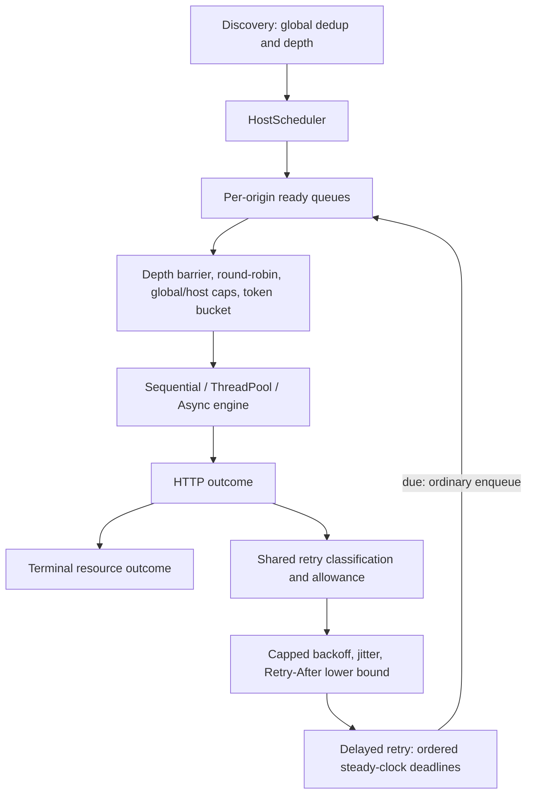

# Retry policy and delayed scheduling

Step 12 adds optional retries to all three engines. It adds no scheduling thread,
retry worker, persistence, adaptive throttling or HTTP cache. Step 13 composes
robots bootstrap with the same retry mechanism; see [robots policy](robots.md).
The clean Step 11 baseline passed 50/50 tests before implementation.

## Configuration and API

`CrawlOptions::retry` is a `RetryPolicy` with `max_retries = 0`,
`initial_backoff = 250ms`, `max_backoff = 5000ms`, `multiplier = 2.0`, and
`jitter = true`. Retries are opt-in to preserve prior crawling and benchmark
semantics. `max_retries = 2` permits **three** attempts: initial, retry 1, retry 2.
Retry count lives on `CrawlItem`, outside URL identity. Initial items have count
zero; a scheduled retry increments it and retains requested URL and depth.

```cpp
options.retry.max_retries = 2;
options.retry.initial_backoff = std::chrono::milliseconds{100};
options.retry.max_backoff = std::chrono::milliseconds{1000};
options.retry.jitter = false;
```

`RetryPolicy::validate()` rejects nonpositive initial delay, cap below initial,
and nonfinite or less-than-one multiplier, even when retries are disabled.
`delay(one_based_retry_number, uniform_sample)` exposes deterministic backoff
calculation. `retryable_status` and `retryable_error` centralize classification.
One shared publication function evaluates outcomes and remaining retry allowance;
engines do not carry separate retry rules.

CLI options are `--max-retries`, `--retry-backoff-ms`,
`--retry-max-backoff-ms`, `--retry-jitter`, and `--no-retry-jitter`. The last jitter
flag wins; option ordering otherwise does not affect policy. Integer parsing
rejects negatives, malformed values and overflow, and delay values must fit the
millisecond representation. The CLI multiplier stays fixed at two; library users
can configure it. No verbose logger was introduced.

## Classification

Retryable HTTP statuses: **429, 500, 502, 503, 504**. Other statuses, including
400/401/403/404/501, are terminal. HTTP errors remain response records; they are
not converted to transport failures.

Only `HttpErrorCode::CurlError` with these curl codes retries:

- `CURLE_OPERATION_TIMEDOUT`
- `CURLE_COULDNT_RESOLVE_HOST`
- `CURLE_COULDNT_CONNECT`
- `CURLE_RECV_ERROR` or `CURLE_SEND_ERROR`
- `CURLE_GOT_NOTHING`
- `CURLE_PARTIAL_FILE`

Host resolution errors can include permanent failures; curl does not distinguish
all transient DNS cases here, so the retry allowance bounds these attempts.
Original curl code/message remain in every failed attempt record. TLS validation,
unsupported protocol, initialization/configuration errors, redirect loops, buffer
allocation failure, body-size limits, invalid effective URL and invalid response
metadata do not retry. Parser recovery and content-type filtering never cause a
retry. Successful redirects remain part of one attempt.

## Backoff, jitter and server guidance

For retry number `n >= 1`, non-jittered delay is
`min(max_backoff, initial_backoff * multiplier^(n-1))`. With 100ms initial,
multiplier two and 1000ms cap, delays are 100, 200, 400, 800, 1000, 1000ms.
A logarithmic cap check avoids unbounded exponentiation for huge retry counts;
no integer multiplication can wrap into a small delay.

Full jitter multiplies that capped value by a uniform sample in `[0,1)` and
rounds down to integer milliseconds. Zero delay is possible. The calculation API
also accepts boundary sample one for deterministic tests. Production uses a
thread-local `mt19937_64`, seeded once per thread on first jittered retry; it has
no shared RNG state or per-retry reseeding. Unit tests inject samples and use a
seeded generator; integration timing checks disable jitter. The stress scenario
enables jitter but asserts bounded counts and completion rather than exact timing.

The focused `HttpResponse::retry_after` and `CrawlResponseMetadata::retry_after`
store optional integer delta-seconds. Header names are ASCII case-insensitive,
surrounding whitespace is trimmed, and malformed, negative, overflow or HTTP-date
values are ignored. If multiple valid values appear, the largest is retained.
Header state resets at every status block, including redirects/informational
responses, so an earlier redirect's guidance cannot leak into the final response.
No generic header map or raw response body is stored in delayed work.

The chosen delay is **max(jittered backoff, Retry-After)** on retryable responses.
The server lower bound is not jittered or clipped to the client backoff cap.
Conversions to steady-clock deadlines saturate at `time_point::max()` rather than
overflow. Extremely large valid server delays can therefore keep work pending
for a very long time; there is no new overall crawl-timeout/cancellation API.
HTTP-date support is future work. This is per-request retry guidance, not an
origin-wide cooldown or adaptive rate change.

## Mechanism and policy



Policy is classification, retry allowance, backoff, jitter and server-delay
precedence. Mechanism is the delayed container, promotion, pending/depth counts,
leases, mutex and wake deadlines.

`HostScheduler::delay(CrawlItem, steady_time)` stores retries in
`multimap<Time, CrawlItem>`. This is an ordered min-deadline structure: insertion
is logarithmic, earliest lookup constant, and due work is promoted from the front.
Equivalent deadlines retain insertion order, independent of pointer addresses.
`delayed()` reports entries not yet promoted. `pending()` includes both ready
and delayed work. `acquire(now)` and `next_deadline(now)` first promote due work.
Promotion preserves delayed entries if ready-queue allocation fails.

Due retries append to ordinary origin queues and participate in round-robin
admission. They bypass `CrawlState::discover`, so global seen count stays stable;
links from recovered pages still use normal global discovery. A retry cannot
bypass global slots, per-origin slots, tokens, or the global attempt budget.
It holds no active lease during backoff. Existing requested-origin redirect
accounting remains: redirect hops do not migrate the lease to the destination.

Delayed entries participate in the existing breadth-first depth barrier. Healthy
ready siblings at the current depth continue during backoff; deeper work waits
until shallower active/pending/delayed work finishes. Fairness applies within that
barrier. Due retries join the normal FIFO at their depth; no separate retry
priority can monopolize admission opportunities across hosts.

## Engine waiting and termination

Sequential publication schedules a failed item and then releases its lease.
The next iteration processes eligible siblings before considering a wait. It
uses `sleep_until` only when no work is currently eligible and a deadline exists.

The threaded coordinator mutex protects delayed insertion/promotion, retry
metadata, result counters, host counts and eligibility checks. Completion releases
its lease under that mutex and notifies all workers. Workers re-evaluate state
after notifications and spurious wakes. `condition_variable::wait_until` releases
the lock while waiting for the earliest token/retry deadline; newly published work
or an earlier retry deadline wakes existing waiters. HTTP work/parsing runs outside
the lock. RNG state is thread-local; fatal processing exceptions release claims,
notify workers, join them and rethrow without returning partial results.

Async retains its single event loop. With active transfers, `curl_multi_poll`
uses the earlier applicable scheduler deadline and its existing timeout bound;
curl may wake sooner for its own timers/readiness. With no active transfers but
future retries, it sleeps until eligibility and refills. Due retries still pass
through ordinary slot filling. Transfer/lease cleanup on setup failure, completion
or fatal unwinding uses the existing ownership rules.

Natural completion requires **zero ready, zero active, zero delayed work**.
Every initial/retry claim consumes one `max_pages` attempt. Budget exhaustion
stops new claims immediately; existing claims finish and publish. Unexecuted
retries are reported as cancelled by budget, not retry-exhausted, and their
entries are destroyed with the per-crawl scheduler. `urls_pending` reports the
unexecuted resources at stop, including these cancelled retries. No backoff wait
occurs after the attempt budget is spent.

## Results, profiling and benchmark compatibility

Records are **per attempt**, with original URL/depth, retry count, latency and
response metadata or original transport/client error. Responses, bytes, failures
and latency metrics remain attempt-level. A 503/503/200 recovery therefore has
three response records and one completed/recovered logical resource.

- `retries_scheduled`: retries inserted for future execution.
- `retries_attempted`: retry attempts whose results were published.
- `retries_exhausted`: retryable terminal outcomes after the enabled allowance ran out.
- `responses_recovered_after_retry`: one terminal 2xx outcome after at least one retry.
- `retry_after_used`: scheduled retries with valid final-response server guidance.
- `retries_cancelled`: scheduled but unattempted retries at the page-budget stop.
- `resources_completed`: terminal resources, including failures.
- `terminal_http_failures` / `terminal_fetch_failures`: terminal status >=400 / HttpError.

At successful return, `scheduled = attempted_retries + cancelled`, and
`resources_completed + urls_pending = urls_discovered`. A retry never increases
seen count. A failed attempt that later recovers stays visible in `fetch_failures`
but does not make the retry-enabled CLI fail. With retries enabled, terminal HTTP
or fetch failures produce exit status one. Disabled-retry CLI HTTP-status behavior
is preserved for compatibility.

Optional `CommonProfile::retry_decisions` counts published outcome evaluations;
`retry_delay` sums requested delays, saturating on overflow. It is planned delay,
not measured idle time; overlapping retries can exceed crawl elapsed time.
Existing threaded idle and async wait durations measure actual engine waits.
Threaded profile merging includes the new fields. The benchmark table shows them;
the existing baseline CSV schema stays unchanged. The baseline benchmark CLI
does not accept retry options, and its library runner rejects nonzero retry
allowances before contacting the fixture. All exported baseline CSV runs thus
have retries disabled. No new retry performance claim or benchmark scenario is
introduced in this phase.

## Tests and reproduction

`core.retry_policy` uses the same explicit steady timestamps as token-bucket
tests. It covers statuses/curl mappings, client exclusions, exact backoff values,
extreme retry counts/multipliers, invalid configuration, deterministic jitter
bounds, Retry-After parsing, deadline order B/C/A, stable ties, delayed-only
pending state, host/token eligibility, and depth barriers.

`tools/multi_origin.py` adds deterministic retry graphs with `/flaky-429`,
`/flaky-503`, `/always-503`, `/not-found`, first-attempt connection close, body
limit, malformed/date/huge Retry-After, cross-origin redirect, healthy, non-HTML
and malformed-HTML cases. Every run gets fresh servers/counters. Shared server
instrumentation records starts and global/per-origin activity.

`retry.integration` checks all engines for recovery/exhaustion, original error
preservation, exact attempt/resource metrics, stable global discovery, healthy
same/cross-origin progress during backoff, future-only work, deadline expiry
while other network transfers are active, rate-after-backoff gating, host caps,
budget stops at 0/1/2/3 attempts, disabled retries, client/parser/MIME exclusions,
header reset across redirects, integer server-delay lower bounds, and huge-delay
budget cancellation. Wall-time bounds are broad; exact arithmetic uses fake time.

`retry.stress` uses four origins and 200 linked resources plus the seed. Fifty
resources fail once, twenty always return 503, and 130 are healthy. Threaded and
async use global capacity 16, origin cap three, two retries, jitter enabled and
10ms initial backoff. A full crawl has **201 logical resources, 291 attempts,
90 retries, 50 recoveries, 20 exhausted resources**, and no pending work. A second
crawl stops at exactly **211 attempts**. The fixture checks exact full-run request
multiplicities, bounded retries, healthy-origin progress and both concurrency caps.
It is labeled `stress`; it remains short in normal builds.

`cli.retry` checks numeric validation, missing arguments, policy relationships,
flag ordering, default disabling, each engine, recovery summaries, permanent HTTP
failure exit status, and baseline benchmark rejection. Unit tests also verify
benchmark-library rejection before network access.

```sh
cmake -S . -B build
cmake --build build -j 4
ctest --test-dir build --output-on-failure
cmake -S . -B build-release -DCMAKE_BUILD_TYPE=Release
cmake --build build-release -j 4
ctest --test-dir build -R '^retry.integration$|^retry.stress$' \
  --repeat until-fail:3 --output-on-failure
```

For a local manual CLI run, start `MultiOrigin` in a Python harness (as the CLI
test does), then invoke:

```sh
./build-release/fluxcrawl --engine async --concurrency 8 --max-retries 3 \
  --retry-backoff-ms 100 --retry-max-backoff-ms 1000 --no-retry-jitter \
  --max-pages 100 http://127.0.0.1:<PORT>/flaky-503
```

The verified summary is three attempts/responses, two retries scheduled/attempted,
one recovered/completed resource, one discovered URL, zero pending, zero exhausted,
zero terminal failures, exit status zero. The fixture records exactly three
requests. All traffic stays on loopback.

## Before robots or persistence

Robots policy now remains separate from retry classification and accounts for
its infrastructure attempts explicitly. Robots attempts have separate records and
counters; CommonProfile outcome decisions include infrastructure evaluations. Persistence needs to store logical discovery
and attempt state separately, define how cancelled/pending retries resume, and
convert remaining steady-clock delays into restart-safe data; raw steady-clock
epoch timestamps cannot be persisted across process restarts. Existing redirect
origin-accounting and lack of an overall cancellation API remain explicit limits.

## Verification — 2026-11-04

- Normal configure/build: passed; complete suite **54/54**, 35.58 seconds.
- Release configure/build: passed.
- ASan + UBSan: complete suite **54/54**, 43.79 seconds, no findings.
- TSan: selected retry/shared-scheduler suites **6/6**, 144.74 seconds, no findings.
- Retry integration and stress: each passed three consecutive runs, 26.11 seconds total.
- Full retry stress: both threaded and async recorded per-origin peaks `3;3;3;3`
  and global peak **12**, consistent with four origins capped at three even with
  global capacity 16. Exact full-run counts were 201 resources / 291 attempts /
  90 retries / 50 recovered / 20 exhausted. The budgeted run stopped at exactly
  211; its recovered/pending/cancelled subset varies with completion and jitter.
- Manual Release async `/flaky-503`: three attempts, two retries, one recovered
  resource, zero pending/exhausted/terminal failures, exit zero; server count three.

Sanitizer commands (their timings are not performance evidence):

```sh
cmake -S . -B build-sanitize -DCMAKE_BUILD_TYPE=Debug \
  -DCMAKE_CXX_FLAGS='-fsanitize=address,undefined -fno-omit-frame-pointer' \
  -DCMAKE_EXE_LINKER_FLAGS='-fsanitize=address,undefined'
cmake --build build-sanitize -j 4
ASAN_OPTIONS=halt_on_error=1 UBSAN_OPTIONS=halt_on_error=1 \
  ctest --test-dir build-sanitize --output-on-failure
cmake -S . -B build-tsan -DCMAKE_BUILD_TYPE=Debug \
  -DCMAKE_CXX_FLAGS='-fsanitize=thread -fno-omit-frame-pointer' \
  -DCMAKE_EXE_LINKER_FLAGS='-fsanitize=thread'
cmake --build build-tsan -j 4
TSAN_OPTIONS=halt_on_error=1 ctest --test-dir build-tsan \
  -R 'core.retry_policy|retry.integration|retry.stress|cli.retry|core.thread_pool_crawler|core.host_scheduler' \
  --output-on-failure
```

Local server tests require permission to bind loopback sockets. Build products,
sanitizer logs and fixture logs remain ignored; no benchmark CSV or retry trace
was added to the repository.
