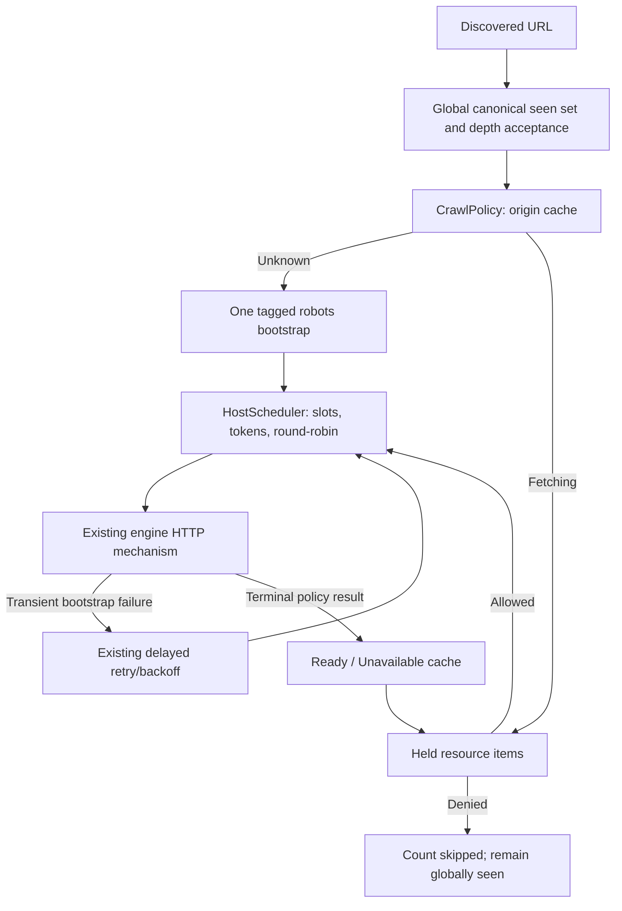

# Robots policy, crawler identity and scheduling

Step 13 adds a shared policy layer to sequential, threaded and async engines.
The clean Step 12 baseline passed **54/54** tests before changes. Robots policy is
opt-in: `CrawlOptions::respect_robots = true` or `--respect-robots`. The default is
ignore for backward compatibility; `--ignore-robots` explicitly selects it. The
last mode flag wins. Public crawls should explicitly select the desired mode.

## Identity and origin

`CrawlerIdentity::product_token` is the fixed `FluxCrawl` robots token.
`CrawlerIdentity{}.user_agent` uses `FluxCrawl/` and the existing version constant.
`HttpClientOptions` derives its default header from that identity. All engines
and their bootstrap requests use the same configured HTTP options. An existing
library-level `HttpClientOptions::user_agent` override changes HTTP headers but
**does not infer/change the robots token**. No arbitrary identity CLI is added.

Policy cache identity is `HostKey`: normalized scheme, host and effective port.
Default ports canonicalize together; nondefault ports and different schemes
remain distinct. `Url::resolve(item.url, "/robots.txt")` constructs the bootstrap
location without splitting or rebuilding origin strings. Redirected policy files
remain associated with the original requested origin.

## Supported matching subset

`RobotsPolicy::parse(text)` produces structured groups and rules.
`allowed(product_token, url)` evaluates a URL without fetching or scheduling.
The reference for group selection and prefix precedence is
[RFC 9309](https://www.rfc-editor.org/rfc/rfc9309.html#section-2.2), but this
implementation deliberately does **not** claim full RFC compliance.

Supported:

- ASCII case-insensitive `User-agent`, `Allow`, and `Disallow` directive names.
- Blank lines, LF/CRLF/CR, surrounding spaces/tabs, UTF-8 BOM, and `#` comments.
  Encoded `%23` remains URL data and is not a comment marker.
- Multiple agents before a group's rules; repeated groups.
- Exact case-insensitive product-token matching. All exact-token groups combine;
  wildcard groups are used only if no exact group exists. An empty specific group
  therefore overrides wildcard restrictions. Partial token strings do not match.
- Literal case-sensitive prefix matching against **path plus query**, including
  `?` when present. Unreserved percent escapes decode; other escapes uppercase
  and remain encoded; raw non-ASCII rule bytes are percent-encoded for comparison.
- Longest matching normalized prefix wins. Allow wins equal-length ties
  independent of directive order. No match allows; empty rules add no restriction.
  `Disallow: /` blocks ordinary paths, while bootstrap always bypasses filtering.

Malformed lines, rules before a group, empty agents, non-path rule values and
unknown directives are ignored. Blank lines do not split a group on their own.
The parser rejects input exceeding 512 KiB before parsing; it creates no regexes,
executes nothing, and keeps no raw response bodies in policy cache state.

Limitations:

- `*` inside a path and `$` are **literal characters**, not pattern operators.
  Rules written for those extensions may not block the URLs their author intended.
- Sitemap discovery, Crawl-delay, advanced extensions and full search-engine
  matching parity are not implemented.
- The implicit direct `/robots.txt` reuse exception is handled by orchestration,
  not by the standalone rule matcher.

## CrawlPolicy and cache lifecycle

`CrawlPolicy` is distinct from `HostScheduler`. It answers whether discovered
work may enter ordinary scheduling; the scheduler controls when admitted work
runs. `schedule(CrawlState&, HostScheduler&, CrawlResult&)` drains globally
accepted discoveries. `resolve(record, parsed_rules, scheduler, result)` completes
a bootstrap. `held()` reports resources waiting for policy.

The cache is `unordered_map<HostKey, Entry, HostKeyHash>` for one crawl. Absence
means Unknown. First acceptance inserts Fetching, retains the resource, and
schedules one tagged bootstrap `CrawlItem`. Further accepted URLs for that origin
join its held vector. Terminal completion makes the entry Ready or Unavailable,
releases allowed held work to host queues, and counts denied work as skipped.
Later discoveries use the cached result. There is no expiry, TTL refresh,
cross-run persistence or background policy thread.



Global dedup occurs before policy acceptance. Blocked, held, pending and active
resources all remain seen, so repeated links cannot churn a denied URL. A policy
skip is not an HTTP failure, consumes no resource attempt and never retries.
Resource retries bypass discovery as before; admitted resources need no repeat
policy check because the cache is fixed for the crawl.

An explicit discovery of the origin's exact `/robots.txt` without query reuses a
completed usable bootstrap (2xx or missing-file response). It increments
`robots_resources_reused` and does not manufacture a normal HTTP attempt/record or
parse robots text as HTML. It remains globally discovered. A seed equal to that
URL can therefore finish with zero normal attempts and one infrastructure fetch.
Unavailable policy still conservatively blocks that discovered resource.

## HTTP behavior and retries

| Terminal bootstrap outcome | Cached decision |
| --- | --- |
| 2xx | Parse the bounded body, regardless of Content-Type |
| 404 or 410 | Ready, unrestricted |
| 401 or 403 | Unavailable, deny all |
| Other nonretryable status/client error | Unavailable, deny all |
| Retryable status/transport error, allowance remains | Keep Fetching and held work; schedule retry |
| Retryable outcome after allowance exhausted | Unavailable, deny all |

The dedicated limit is **512 KiB decoded bytes**, independent of the normal page
body setting. `HttpClient::fetch(url, body_limit)` and async transfer configuration
apply it before parser input is retained. Body-limit errors do not retry. Parser
allocation/other unexpected processing exceptions remain fatal engine exceptions;
existing lease/worker/multi-handle cleanup still applies.

Bootstrap classification uses the same HTTP set (429/500/502/503/504), selected
curl errors, capped backoff, jitter and integer Retry-After lower bound as resource
retries. Retry allowance defaults to zero unless configured. A transient first
failure does not prematurely deny held work. Bootstrap retry state stays separate
from canonical URL identity and does not pass through discovery dedup.

2xx parseable empty/unknown-only content imposes no rules; this implementation
does not detect HTML soft-404 pages. The 401/403 and other-error fallback is an
explicit conservative local policy, not a claim that every RFC implementation
must use the same fallback.

## Scheduling, locking, deadlines and budgets

Bootstrap work is tagged with `policy_request = true`. The tag affects policy
completion and accounting, not host eligibility. Infrastructure claims consume
ordinary global capacity, host active slots and rate tokens. They bypass only the
robots check. Bootstrap retries use the same delayed container and deadlines.
Normal work is not placed into host queues until policy resolves.

Sequential fetches seed policy first, then the allowed seed; it uses ordinary
scheduler deadlines for policy retries. A denied seed completes cleanly with no
resource request. Threaded cache transitions, held vectors, scheduler mutations
and counters all share the existing coordinator mutex. Rules parse outside that
mutex during response processing. One completion publishes policy, releases its
claim and notifies waiters. Workers remain free to claim other eligible origins.
Async uses the existing transfer map and event loop, with policy-specific shared
publication rather than a second loop or blocking policy fetch.

Existing breadth-first barriers remain. Bootstrap and its retries use the held
resource's depth as a scheduling barrier but do **not increment graph depth**.
Other origins at the current depth can continue while one policy fetch is slow;
deeper work can still wait behind that depth barrier. No exact completion order
or equal throughput is promised.

Only normal resource claims consume `max_pages`. A zero budget performs no
network request, leaving the seed pending even though a bootstrap may have been
queued internally. Once the budget is spent, no new infrastructure/resource claim
starts; active requests finish publishing. Future bootstrap retries and unresolved
held resources remain reported as pending/cancelled and are destroyed at teardown.
Thus infrastructure is not a way to keep a budget-exhausted crawl alive forever.
Natural completion includes both scheduler work and held-policy resolution: held
items always have a bootstrap pending/active until a terminal policy decision.

`HostScheduler::resource_pending()` excludes ready/delayed infrastructure entries;
result pending resources are that count plus `CrawlPolicy::held()`. Normal engine
termination still uses total scheduler pending/active state, including bootstrap.

## Accounting and visibility

- `robots_origins`: cache/bootstrap operations initialized, including queued ones.
- `robots_fetches`: attempted bootstrap transfers, including retries; redirect hops
  are part of a transfer, as in ordinary request accounting.
- `robots_cache_hits`: accepted discoveries whose origin cache entry already exists,
  including Fetching entries; duplicate URL discoveries do not reach this layer.
- `robots_allowed`: allowed unique discoveries, including direct bootstrap reuse.
- `urls_blocked_by_robots`: denied discoveries, including conservative fallback.
- `robots_fetch_failures`: origins reaching terminal acquisition failure, not every
  transient attempt; missing files and recovered bootstrap failures do not count.
- `robots_retries_scheduled`, `robots_retries_attempted`, `robots_retries_cancelled`:
  infrastructure retry lifecycle, separate from resource retry metrics.
- `robots_resources_reused`: direct robots discoveries satisfied by infrastructure.

`robots_records` retains per-bootstrap metadata/error, retry count and latency,
without bodies. `records`, attempt/response/failure/byte/latency metrics and HTML
counts continue to describe normal resources. Optional common profiling decisions
and engine wait/activity statistics include infrastructure processing; normal
benchmark runs explicitly exclude it.

At return:

```text
resources_completed + urls_blocked_by_robots + robots_resources_reused
    + urls_pending == urls_discovered
robots_fetches == robots_records.size()
robots_retries_scheduled == robots_retries_attempted + robots_retries_cancelled
```

The CLI prints policy counters only in respect mode. Denied resources alone are a
successful policy stop (exit zero); a terminal robots acquisition failure returns
exit one. Existing resource retry/transport exit behavior remains unchanged.

## Benchmarks and tests

The baseline benchmark explicitly disables robots in its crawl options and rejects
library requests to enable it before contacting a fixture. Its CLI does not accept
robots flags. Existing CSV schema therefore continues to represent robots-ignore
runs; old workload counts and performance comparisons are not silently mixed
with bootstrap traffic. No new benchmark campaign or performance claim is added.

`core.robots_policy` covers parser tolerance, group selection, repeated groups,
multiple agents, empty/root disallow, longest match/ties, query/encoding cases,
literal extension behavior, parser bound, versioned identity, origin port
separation, global seen retention, held-work resolution, direct robots reuse,
and a single bootstrap for 102 unique discoveries on one origin.

`robots.integration` tests all engines with mixed policies; blocked seeds and
paths; 404/410, 401/403, body limits, transport close and permanent/transient 503;
redirected robots; one fetch for over 100 same-origin discoveries; token use by
bootstrap; zero budget; resource recovery; slow-origin independence; and a race
graph where 24 publisher pages repeatedly discover the same 100 new-origin URLs.
The threaded test uses 16 workers; it verifies one bootstrap for that new origin.

`robots.stress` uses eight origins, 100 linked URLs each, plus one retrying resource
per origin and the seed: **809 discovered resources**. Four origins deny 20 private
paths each while allowing public exceptions. Missing-file origins allow all; one
origin's policy fails once then succeeds. With 16 workers/transfers and cap three,
full threaded/async runs require **737 resource attempts, 80 policy skips, eight
resource recoveries, nine policy attempts for eight bootstrap operations**.
A separate run stops at exactly 37 resource attempts. Tests check no blocked
requests, bounded request multiplicities, host/global caps and termination.
The stress test is labeled separately. Timings are not performance conclusions.

`cli.robots` checks both flags and ordering, summaries, fallback status, engine
identity parity, explicit ignore compatibility and benchmark rejection. All
traffic uses local servers; no public robots file is used as test data.

## Reproduction and snapshot recovery boundaries

```sh
cmake -S . -B build
cmake --build build -j 4
ctest --test-dir build --output-on-failure
cmake -S . -B build-release -DCMAKE_BUILD_TYPE=Release
cmake --build build-release -j 4
ctest --test-dir build -R '^robots.integration$|^robots.stress$' \
  --repeat until-fail:3 --output-on-failure
```

For the local CLI demonstration, a Python `RobotsFixture` harness starts four
origins and invokes:

```sh
./build-release/fluxcrawl --engine async --concurrency 8 --max-per-host 2 \
  --respect-robots --max-retries 2 --retry-backoff-ms 80 --no-retry-jitter \
  --depth 3 --max-pages 100 http://127.0.0.1:<PORT>/
```

Observed: **11 resource attempts/responses, 17 discovered, zero pending, five
robots fetches for four origins, 13 cache hits, 15 allowed, two blocked, four
bootstrap responses reused, one robots retry, zero acquisition failures, exit
zero**. Server robots request counts are `[1,1,1,2]`; denied resources never arrive.

[Step 14 snapshots](checkpointing.md) now preserve discovery and unfinished work,
while reacquiring robots policy for unfinished origins after restart. Previously
blocked/completed URLs remain seen and are not requeued. Parsed policy/cache state
still has no cross-run persistence or TTL. Across resumed sessions, allowed/cache-hit
counters include reevaluation of unfinished work; origin counts can count a fresh
bootstrap operation for an already encountered origin.

**Redirect limitation:** policy checks protect requested crawl items, not every
HTTP redirect hop. Both ordinary and robots transfers can follow redirects under
the existing HTTP client rules, potentially contacting another origin/path
without consulting its robots cache or moving its host lease. Supporting per-hop
policy enforcement requires a separate redirect design. Robots rules are advisory
crawl policy, not access authorization. There is no sitemap crawling, Crawl-delay,
SQLite live storage, Bloom filter, frontend, rendering or JavaScript execution.

## Verification — 2026-11-04

- Normal configure/build and complete suite: **58/58 passed**, 74.44 seconds.
  The run overlapped compilation; its elapsed time is not a benchmark result.
- Release configure/build: passed.
- ASan + UBSan: complete suite **58/58 passed**, 52.23 seconds, no findings.
- TSan: six selected policy/shared-concurrency suites passed, 158.06 seconds,
  no findings, including concurrent bootstrap, held queues, retries and stress.
- Robots integration and stress each passed three consecutive runs; 25.14 seconds
  total. Each race graph retained exactly one bootstrap for its newly found origin.
- Full stress threaded and async both reached global activity **16**, with all
  eight per-origin peaks exactly **3**. Each had 737 resource attempts, 80 skips,
  nine bootstrap attempts and eight recovered resources. Budgeted runs stopped at
  exactly 37 resource attempts; unresolved held work and cancelled retries were
  reported without waiting for the policy retry deadline.
- Manual Release four-origin run produced the exact summary above. No public
  traffic, new performance claims or benchmark artifacts were introduced.

Sanitizer commands:

```sh
cmake -S . -B build-sanitize -DCMAKE_BUILD_TYPE=Debug \
  -DCMAKE_CXX_FLAGS='-fsanitize=address,undefined -fno-omit-frame-pointer' \
  -DCMAKE_EXE_LINKER_FLAGS='-fsanitize=address,undefined'
cmake --build build-sanitize -j 4
ASAN_OPTIONS=halt_on_error=1 UBSAN_OPTIONS=halt_on_error=1 \
  ctest --test-dir build-sanitize --output-on-failure
cmake -S . -B build-tsan -DCMAKE_BUILD_TYPE=Debug \
  -DCMAKE_CXX_FLAGS='-fsanitize=thread -fno-omit-frame-pointer' \
  -DCMAKE_EXE_LINKER_FLAGS='-fsanitize=thread'
cmake --build build-tsan -j 4
TSAN_OPTIONS=halt_on_error=1 ctest --test-dir build-tsan \
  -R 'core.robots_policy|robots.integration|robots.stress|cli.robots|core.host_scheduler|core.thread_pool_crawler' \
  --output-on-failure
```

Local test execution requires loopback socket permissions. Sanitizer logs, build
products and temporary server data remain ignored.
